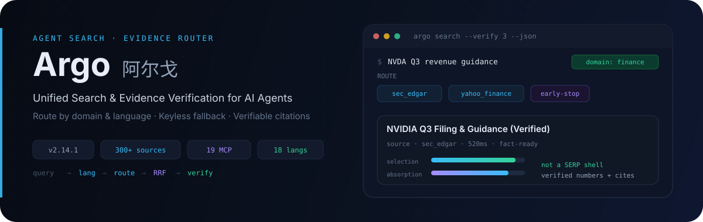

<p align="center">
  
</p>

<p align="center">
  <a href="README.md">English</a> ·
  <a href="README.zh.md">中文</a> ·
  <strong>日本語</strong> ·
  <a href="README.ko.md">한국어</a> ·
  <a href="README.es.md">Español</a>
</p>

<p align="center">
  <a href="https://github.com/taxueseek/argo/stargazers"></a>
  <a href="https://www.npmjs.com/package/argo-search"></a>
  <a href="https://skills.sh/taxueseek/argo"></a>
  
  
  
  
  
</p>

**Argo（アルゴ）** は AI エージェント向けに設計されたオープンソースのマルチエンジン検索・Web 取得・エビデンス検証ツールです。**クレジットカードや有料 API キー不要**で即座に動作し、18 言語（日本語・英語・中国語・韓国語など）の一次ソースへ自動ルーティングします。

---

## クイックスタート

- **Claude Code（MCP）**：
  ```bash
  claude mcp add argo -- npx -y argo-search
  ```
- **Agent Skill（`skills.sh` — Claude Code / Cursor / Codex）**：
  ```bash
  npx skills add taxueseek/argo
  ```
- **Cursor / Windsurf（`mcpServers` JSON）**：
  ```json
  {
    "mcpServers": {
      "argo": { "command": "npx", "args": ["-y", "argo-search"] }
    }
  }
  ```
- **ローカル CLI**：
  ```bash
  curl -fsSL https://raw.githubusercontent.com/taxueseek/argo/main/scripts/install.sh | bash
  ```

---

## なぜ Argo なのか

| 比較項目 | 標準 Web 検索 | 商用検索 API（Tavily / Exa） | Argo |
| :--- | :--- | :--- | :--- |
| **コスト・API キー** | ホスト枠に依存 | 従量課金・API キー必須 | **キー不要の無料フォールバック**（キーがあれば自動強化） |
| **日本語・多言語対応** | 英語中心になりがち | 汎用インデックスのみ | **18 言語対応・ドメイン別ルーティング**（学術 / 技術 / 金融） |
| **根拠検証** | スニペットのみ | スニペット中心 | **`--verify` で本文を取得し信頼性スコアを算出** |
| **ローカル検索** | なし | なし | **ローカルファイル + セマンティックノート検索（`local-seek`）** |

```bash
# 実行例：日本語技術クエリを検証付きで取得（コンテキスト節約の agent 出力）
argo search "Rust async tokio エラーハンドリング" --verify 2 --json --fields agent
```

---

## 主な機能・ドキュメント

- **19 個の MCP ツール**（`argo_search`、`argo_fetch`、`argo_research`、`argo_evidence`、`argo_local_search` など）および 4 つのサブスキル（`local-search`、`local-seek`、`ego-search`、`js-run`）を搭載。
- **DSH プラグイン**（`dsh plugin --profile web add argo-search`）は 18 個のネイティブツールと並列リサーチを提供（詳細は [packages/dsh-plugin/README.md](packages/dsh-plugin/README.md)）。
- 詳細ドキュメント：[docs/ENGINE_CATALOG.md](docs/ENGINE_CATALOG.md) · [docs/MCP_SETUP.md](docs/MCP_SETUP.md) · [docs/CHANGELOG.md](docs/CHANGELOG.md)

| バージョン | 主な変更点 |
| :--- | :--- |
| **v2.14.1** | ソースアーキテクチャのスリム化、MCP 3+1 ツール統合と互換エイリアス、304 ソース対応、`secret_guard.py` 機密マスキング |
| **v2.14.0** | パーサー層統合、300 ソース到達、バッドケース台帳ループ |
| **v2.13.0** | ドキュメント統合、22 ステートマシン SSOT、ディスパッチ待機改善 |

<details>
<summary>v2.14.1 リリース概要・機能サマリー</summary>

### 現時点の能力概要（v2.14.1）

v2.14.1 ではソースアーキテクチャのスリム化、キー不要ソース追加、MCP 3+1 統合と互換エイリアス、および `secret_guard.py` による機密マスキングを実装しました。

### v2.14.1：アーキテクチャのスリム化 + MCP 3+1 ツール + セキュリティ編集

詳細は [docs/RELEASE_NOTES_v2.14.1.md](docs/RELEASE_NOTES_v2.14.1.md) をご参照ください。

</details>
