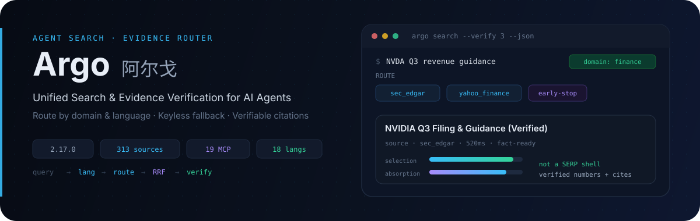

<p align="center">
  
</p>

<p align="center">
  <a href="README.md">English</a> ·
  <a href="README.zh.md">中文</a> ·
  <strong>日本語</strong> ·
  <a href="README.ko.md">한국어</a> ·
  <a href="README.es.md">Español</a>
</p>

<p align="center">
  <a href="https://github.com/taxueseek/argo/stargazers"></a>
  <a href="https://www.npmjs.com/package/argo-search"></a>
  <a href="https://skills.sh/taxueseek/argo"></a>
  
  
  
  
  
</p>

> **taxueseek スキルシリーズ**（検索・ディープリサーチ担当）：[plainspoken-writing](https://github.com/taxueseek/plainspoken-writing) 75★ · [session-digger](https://github.com/taxueseek/session-digger) 34★ · [taxue-invest](https://github.com/taxueseek/taxue-invest) 30★ · [taxueskills](https://github.com/taxueseek/taxueskills) 25★ · [taxue-creative-style](https://github.com/taxueseek/taxue-creative-style) 19★ · [ime-lexicon](https://github.com/taxueseek/ime-lexicon) 15★ | **DSH プラグイン**：[dsh-files](https://github.com/taxueseek/dsh-files) 43★ · [plugin-fast-adapt](https://github.com/taxueseek/plugin-fast-adapt) 15★ · [dsh-plugin-guard](https://github.com/taxueseek/dsh-plugin-guard) 2★

**Argo（アルゴ）** は AI エージェント向けに設計されたオープンソースのマルチエンジン検索・Web 取得・エビデンス検証ツールです。**クレジットカードや有料 API キー不要**で即座に動作し、18 言語（日本語・英語・中国語・韓国語など）の一次ソースへ自動ルーティングします。

---

## クイックスタート

- **Claude Code（MCP）**：
  ```bash
  claude mcp add argo -- npx -y argo-search
  ```
- **Agent Skill（`skills.sh` — Claude Code / Cursor / Codex）**：
  ```bash
  npx skills add taxueseek/argo
  ```
- **Cursor / Windsurf（`mcpServers` JSON）**：
  ```json
  {
    "mcpServers": {
      "argo": { "command": "npx", "args": ["-y", "argo-search"] }
    }
  }
  ```
- **ローカル CLI**：
  ```bash
  curl -fsSL https://raw.githubusercontent.com/taxueseek/argo/main/scripts/install.sh | bash
  ```

---

## なぜ Argo なのか

| 比較項目 | 標準 Web 検索 | 商用検索 API（Tavily / Exa） | Argo |
| :--- | :--- | :--- | :--- |
| **コスト・API キー** | ホスト枠に依存 | 従量課金・API キー必須 | **キー不要の無料フォールバック**（キーがあれば自動強化） |
| **日本語・多言語対応** | 英語中心になりがち | 汎用インデックスのみ | **18 言語対応・ドメイン別ルーティング**（学術 / 技術 / 金融） |
| **根拠検証** | スニペットのみ | スニペット中心 | **`--verify` で本文を取得し信頼性スコアを算出** |
| **ローカル検索** | なし | なし | **ローカルファイル + セマンティックノート検索（`local-seek`）** |

```bash
# 実行例：日本語技術クエリを検証付きで取得（コンテキスト節約の agent 出力）
argo search "Rust async tokio エラーハンドリング" --verify 2 --json --fields agent
```

---

## 主な機能・ドキュメント

- **AI 検索統合**：キー不要チャネル（`tavily_free`、`parallel_free`、`anysearch`）に加え、**DeepSeek Search**・**Tencent Yuanbao (混元)**・**Metaso**・**Bocha**・**Tavily**・**Exa** などの主要 AI 検索を単一インターフェースで統合ルーティング。
- **19 個の MCP ツール**（`argo_search`、`argo_fetch`、`argo_research`、`argo_evidence`、`argo_local_search` など）、3 つの独立 Skill（`argo`、`argo-wide-research`、`local-seek`）および内部パイプライン（`local-search`、`ego-search`、`js-run`）を搭載。
- **DSH プラグイン**（`dsh plugin --profile web add argo-search`）は 18 個のネイティブツール・35 個の挙動スイッチ・並列リサーチを提供（詳細は [packages/dsh-plugin/README.md](packages/dsh-plugin/README.md)）。
- 詳細ドキュメント：[docs/ENGINE_CATALOG.md](docs/ENGINE_CATALOG.md) · [docs/MCP_SETUP.md](docs/MCP_SETUP.md) · [docs/CHANGELOG.md](docs/CHANGELOG.md)

| バージョン | 主な変更点 |
| :--- | :--- |
| **v2.16.0** | DSH Argo Workbench UI、CLI 4段階検証パイプライン、`linux.do` + Keenable 無料チャネル（312ソース）、Jina キー不要フォールバック、並行・キャッシュ制御強化 |
| **v2.15.0** | Zhihu フルチェーン、証拠レイヤー権威透過、キー不要セマンティックフォールバック、MCP 汎用コネクタ（`type: mcp`）、ルーティング ゼロベース評価、311 ソース |
| **v2.14.1** | ソースアーキテクチャのスリム化、MCP 3+1 ツール統合と互換エイリアス、304 ソース対応、`secret_guard.py` 機密マスキング |
| **v2.14.0** | パーサー層統合、300 ソース到達、バッドケース台帳ループ |
| **v2.13.0** | ドキュメント統合、22 ステートマシン SSOT、ディスパッチ待機改善 |

<details>
<summary>v2.16.0 リリース概要・機能サマリー</summary>

### 現時点の能力概要（v2.16.0）

v2.16.0 では DSH プラグインにブラウザ版 **Argo Workbench**（5モード、適応型ホーム提案、左右2ペインの引用・根拠検証ビュー）を追加し、`bin/argo` CLI 4段階検証パイプラインと `local-seek` ローカル検索を統合しました。さらに `linux.do` ソース追加（311→312）および `keenable` 無料チャネル（月10万回）有効化、Jina Reader のキー不要フォールバック、サーキットブレーカー・クォータ・キャッシュスロットの並行制御強化を実施しました。

### v2.16.0：Argo Workbench UI + CLI 4段階検証 + ソース・並行制御強化

詳細は [docs/RELEASE_NOTES_v2.16.0.md](docs/RELEASE_NOTES_v2.16.0.md) をご参照ください。

### v2.15.0：Zhihu フルチェーン + 証拠レイヤー権威透過 + MCP コネクタ

詳細は [docs/RELEASE_NOTES_v2.15.0.md](docs/RELEASE_NOTES_v2.15.0.md) をご参照ください。

### v2.14.1：アーキテクチャのスリム化 + MCP 3+1 ツール + セキュリティ編集

詳細は [docs/RELEASE_NOTES_v2.14.1.md](docs/RELEASE_NOTES_v2.14.1.md) をご参照ください。

</details>

---

> 良い検索は、もっと多く見せることではない。自信を持って結論できること——そしてまだ結論してはいけないときを知ることだ。

<p align="center">
  <picture>
    <source media="(prefers-color-scheme: dark)"
      srcset="https://api.star-history.com/svg?repos=taxueseek/argo&type=Date&theme=dark" />
    <source media="(prefers-color-scheme: light)"
      srcset="https://api.star-history.com/svg?repos=taxueseek/argo&type=Date" />
    
  </picture>
</p>

Argo がより確かな結論を下す助けになったなら、[Star](https://github.com/taxueseek/argo/stargazers) を押して、より多くの人に届けてください。
