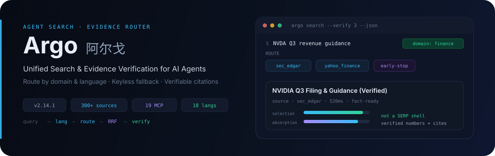

<p align="center">
  
</p>

<p align="center">
  <a href="README.md">English</a> ·
  <a href="README.zh.md">中文</a> ·
  <a href="README.ja.md">日本語</a> ·
  <strong>한국어</strong> ·
  <a href="README.es.md">Español</a>
</p>

<p align="center">
  <a href="https://github.com/taxueseek/argo/stargazers"></a>
  <a href="https://www.npmjs.com/package/argo-search"></a>
  <a href="https://skills.sh/taxueseek/argo"></a>
  
  
  
  
  
</p>

**Argo(아르고)**는 AI 에이전트를 위한 오픈소스 멀티 엔진 검색·웹 수집·증거 검증 도구입니다. **유료 API 키 없이도 무료 로컬 폴백으로 즉시 실행**되며, 18개 언어와 도메인(학술, 코드, 금융, 뉴스)에 맞춰 자동 라우팅하고 원문 기반 신뢰도 검증을 제공합니다.

---

## 빠른 시작

- **Claude Code (MCP)**:
  ```bash
  claude mcp add argo -- npx -y argo-search
  ```
- **Agent Skill (`skills.sh` — Claude Code / Cursor / Codex)**:
  ```bash
  npx skills add taxueseek/argo
  ```
- **Cursor / Windsurf (`mcpServers` JSON)**:
  ```json
  {
    "mcpServers": {
      "argo": { "command": "npx", "args": ["-y", "argo-search"] }
    }
  }
  ```
- **로컬 CLI**:
  ```bash
  curl -fsSL https://raw.githubusercontent.com/taxueseek/argo/main/scripts/install.sh | bash
  ```

---

## 왜 Argo인가

| 비교 항목 | 내장 검색 | 상용 API (Tavily / Exa) | Argo |
| :--- | :--- | :--- | :--- |
| **비용 및 API 키** | 호스트 할당량 의존 | 종량제 과금 · API 키 필수 | **무키 무료 폴백** (키가 있으면 자동 품질 향상) |
| **다국어 · 도메인 라우팅** | 단일 범용 인덱스 | 일반 웹 인덱스 | **18개 언어 · 학술/코드/금융 1차 소스 자동 라우팅** |
| **사실 검증** | 스니펫만 반환 | 스니펫 중심 | **`--verify`로 원문 본문 수집 및 신뢰도 점수 산출** |
| **로컬 검색** | 없음 | 없음 | **로컬 파일 + 시맨틱 노트 검색 (`local-seek`)** |

```bash
# 실행 예시: 원문 검증 포함 에이전트용 압축 JSON 출력
argo search "LLM 에이전트 RAG 최신 아키텍처" --verify 2 --json --fields agent
```

---

## 주요 기능 및 문서

- **MCP 도구 19개** (`argo_search`, `argo_fetch`, `argo_research`, `argo_evidence`, `argo_local_search` 등) 및 4개 서브 스킬(`local-search`, `local-seek`, `ego-search`, `js-run`) 제공.
- **DSH 플러그인** (`dsh plugin --profile web add argo-search`): 18개 네이티브 도구 및 병렬 리서치 오케스트레이션 지원 ([packages/dsh-plugin/README.md](packages/dsh-plugin/README.md)).
- 전체 문서: [docs/ENGINE_CATALOG.md](docs/ENGINE_CATALOG.md) · [docs/MCP_SETUP.md](docs/MCP_SETUP.md) · [docs/CHANGELOG.md](docs/CHANGELOG.md)

| 버전 | 주요 업데이트 |
| :--- | :--- |
| **v2.14.1** | 아키텍처 슬리밍, MCP 3+1 도구 수렴 및 호환 별칭, 304개 소스, `secret_guard.py` 보안 마스킹 |
| **v2.14.0** | 파서 계층 통합, 300개 소스, 배드케이스 원장 루프 |
| **v2.13.0** | 문서 통합, 22개 상태 머신 SSOT, 디스패치 테일 유예 |

<details>
<summary>v2.14.1 릴리스 요약 및 기능 개요</summary>

### 현재 기능 개요 (v2.14.1)

v2.14.1에서는 소스 아키텍처 슬리밍, 무인증 소스 확장, MCP 3+1 수렴 및 호환 별칭, `secret_guard.py` 기반 보안 마스킹이 적용되었습니다.

### v2.14.1: 아키텍처 슬리밍 + MCP 3+1 도구 + 보안 마스킹

자세한 내용은 [docs/RELEASE_NOTES_v2.14.1.md](docs/RELEASE_NOTES_v2.14.1.md)를 참고하세요.

</details>
