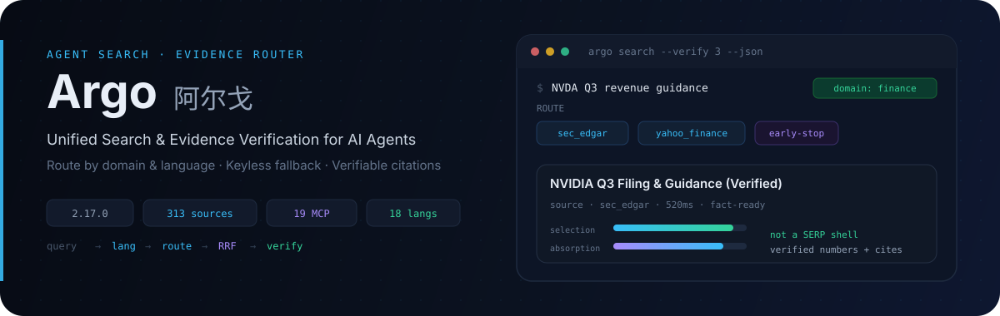

<p align="center">
  
</p>

<p align="center">
  <a href="README.md">English</a> ·
  <a href="README.zh.md">中文</a> ·
  <a href="README.ja.md">日本語</a> ·
  <strong>한국어</strong> ·
  <a href="README.es.md">Español</a>
</p>

<p align="center">
  <a href="https://github.com/taxueseek/argo/stargazers"></a>
  <a href="https://www.npmjs.com/package/argo-search"></a>
  <a href="https://skills.sh/taxueseek/argo"></a>
  
  
  
  
  
</p>

> **taxueseek 스킬 시리즈** (검색·딥리서치): [plainspoken-writing](https://github.com/taxueseek/plainspoken-writing) 77★ · [session-digger](https://github.com/taxueseek/session-digger) 34★ · [taxue-invest](https://github.com/taxueseek/taxue-invest) 30★ · [taxueskills](https://github.com/taxueseek/taxueskills) 25★ · [taxue-creative-style](https://github.com/taxueseek/taxue-creative-style) 19★ · [ime-lexicon](https://github.com/taxueseek/ime-lexicon) 16★ | **DSH 플러그인**: [plugin-fast-adapt](https://github.com/taxueseek/plugin-fast-adapt) 48★ · [dsh-files](https://github.com/taxueseek/dsh-files) 44★ · [taxue-dsh-artisan](https://github.com/taxueseek/taxue-dsh-artisan) 3★ · [dsh-plugin-guard](https://github.com/taxueseek/dsh-plugin-guard) 2★

**Argo(아르고)**는 AI 에이전트를 위한 오픈소스 멀티 엔진 검색·웹 수집·증거 검증 도구입니다. **유료 API 키 없이도 무료 로컬 폴백으로 즉시 실행**되며, 18개 언어와 도메인(학술, 코드, 금융, 뉴스)에 맞춰 자동 라우팅하고 원문 기반 신뢰도 검증을 제공합니다.

---

## 빠른 시작

- **Claude Code (MCP)**:
  ```bash
  claude mcp add argo -- npx -y argo-search
  ```
- **Agent Skill (`skills.sh` — Claude Code / Cursor / Codex)**:
  ```bash
  npx skills add taxueseek/argo
  ```
- **Cursor / Windsurf (`mcpServers` JSON)**:
  ```json
  {
    "mcpServers": {
      "argo": { "command": "npx", "args": ["-y", "argo-search"] }
    }
  }
  ```
- **로컬 CLI**:
  ```bash
  curl -fsSL https://raw.githubusercontent.com/taxueseek/argo/main/scripts/install.sh | bash
  ```

---

## 왜 Argo인가

| 비교 항목 | 내장 검색 | 상용 API (Tavily / Exa) | Argo |
| :--- | :--- | :--- | :--- |
| **비용 및 API 키** | 호스트 할당량 의존 | 종량제 과금 · API 키 필수 | **무키 무료 폴백** (키가 있으면 자동 품질 향상) |
| **다국어 · 도메인 라우팅** | 단일 범용 인덱스 | 일반 웹 인덱스 | **18개 언어 · 학술/코드/금융 1차 소스 자동 라우팅** |
| **사실 검증** | 스니펫만 반환 | 스니펫 중심 | **`--verify`로 원문 본문 수집 및 신뢰도 점수 산출** |
| **로컬 검색** | 없음 | 없음 | **로컬 파일 + 시맨틱 노트 검색 (`local-seek`)** |

```bash
# 실행 예시: 원문 검증 포함 에이전트용 압축 JSON 출력
argo search "LLM 에이전트 RAG 최신 아키텍처" --verify 2 --json --fields agent
```

---

## 주요 기능 및 문서

- **AI 검색 통합**: 무료 채널(`tavily_free`, `parallel_free`, `anysearch`)과 **DeepSeek Search**, **Tencent Yuanbao (혼원)**, **Metaso**, **Bocha**, **Tavily**, **Exa** 등 주요 AI 검색 엔진을 단일 라우터로 통합.
- **MCP 도구 19개** (`argo_search`, `argo_fetch`, `argo_research`, `argo_evidence`, `argo_local_search` 등), 3개 독립 스킬(`argo`, `argo-wide-research`, `local-seek`) 및 내부 파이프라인(`local-search`, `ego-search`, `js-run`) 제공.
- **DSH 플러그인** (`dsh plugin --profile web add argo-search`): 18개 네이티브 도구, 35개 동작 스위치 및 병렬 리서치 오케스트레이션 지원 ([packages/dsh-plugin/README.md](packages/dsh-plugin/README.md)).
- 전체 문서: [docs/ENGINE_CATALOG.md](docs/ENGINE_CATALOG.md) · [docs/MCP_SETUP.md](docs/MCP_SETUP.md) · [docs/CHANGELOG.md](docs/CHANGELOG.md)

| 버전 | 주요 업데이트 |
| :--- | :--- |
| **v2.18.0** | `--agent` 및 `--intent` 라우팅, 통합 `fetch_dispatch`, 모듈화된 `local-seek` `--symbol-body` 및 Workbench 연동, `@OMSociety` 커뮤니티 PR 4건 통합(Zhihu 지정 답변 수집, X 키워드 검증 및 단건 폴백, 이미지 메타데이터 유지, DSH 락 초기화 수정, 314개 소스) |
| **v2.17.0** | 쿼리 연산자 네이티브 푸시다운, 4상태 브라우저 인증 및 `ego-search` 프로세스 간 페이싱, 결정론적 근거 앵커링, Workbench 일일 핫토픽 및 TCP 루프백 가드(313개 소스) |
| **v2.16.0** | DSH Argo Workbench UI, CLI 4단계 검증 파이프라인, `linux.do` + Keenable 무료 채널(312개 소스), Jina 키리스 폴백, 동시성·캐시 상태 머신 강화 |
| **v2.15.0** | Zhihu 전체 체인, 증거 레이어 권위 전달, 키 없는 시맨틱 폴백, MCP 범용 커넥터(`type: mcp`), 라우팅 제로베이스 평가, 311개 소스 |
| **v2.14.1** | 아키텍처 슬리밍, MCP 3+1 도구 수렴 및 호환 별칭, 304개 소스, `secret_guard.py` 보안 마스킹 |
| **v2.14.0** | 파서 계층 통합, 300개 소스, 배드케이스 원장 루프 |
| **v2.13.0** | 문서 통합, 22개 상태 머신 SSOT, 디스패치 테일 유예 |

<details>
<summary>v2.18.0 릴리스 요약 및 기능 개요</summary>

### 현재 기능 개요 (v2.18.0)

v2.18.0에서는 Agent 우선 진입점, 전용 URL 수집 및 커뮤니티 소셜 검색 기능을 통합 강화했습니다. `--agent` 스위치와 `--intent` 라우팅(`intent_router.py`), WeChat·X·arXiv·PDF 통합 분기(`fetch_dispatch.py`), `local-seek`의 `--outline` 범위 및 `--symbol-body` 심볼 원문 직독과 Workbench 직결(`local-inspect`·`note-study`), L2 변경 감지 테스트 선택(`affected_tests.py`)을 도입했습니다. 또한 `@OMSociety`의 커뮤니티 PR 4건(#52/#53/#54/#55: Zhihu 지정 답변 본문 및 페이징 요약 수집, X 키워드 검증 라우팅과 단건 FxTwitter 폴백(313→314), agent 출력 이미지 메타데이터 유지, DSH 상태 락 디렉터리 초기화 수정)을 원작자 서명과 함께 반영했습니다.

### v2.18.0: Agent 진입점 + 통합 `fetch_dispatch` + 커뮤니티 PR (#52–#55)

자세한 내용은 [docs/RELEASE_NOTES_v2.18.0.md](docs/RELEASE_NOTES_v2.18.0.md)를 참고하세요.

### v2.17.0: 쿼리 네이티브 푸시다운 + 인증·근거 강화 + Workbench 일일 핫토픽

자세한 내용은 [docs/RELEASE_NOTES_v2.17.0.md](docs/RELEASE_NOTES_v2.17.0.md)를 참고하세요.

### v2.16.0: Argo Workbench UI + CLI 4단계 검증 + 소스·동시성 강화

자세한 내용은 [docs/RELEASE_NOTES_v2.16.0.md](docs/RELEASE_NOTES_v2.16.0.md)를 참고하세요.

### v2.15.0: Zhihu 전체 체인 + 증거 레이어 권위 전달 + MCP 커넥터

자세한 내용은 [docs/RELEASE_NOTES_v2.15.0.md](docs/RELEASE_NOTES_v2.15.0.md)를 참고하세요.

### v2.14.1: 아키텍처 슬리밍 + MCP 3+1 도구 + 보안 마스킹

자세한 내용은 [docs/RELEASE_NOTES_v2.14.1.md](docs/RELEASE_NOTES_v2.14.1.md)를 참고하세요.

</details>

---

> 좋은 검색은 더 많이 보는 것이 아니라, 자신 있게 결론 내리고, 아직 결론 내리면 안 될 때를 아는 것입니다.

<p align="center">
  <picture>
    <source media="(prefers-color-scheme: dark)"
      srcset="https://api.star-history.com/svg?repos=taxueseek/argo&type=Date&theme=dark" />
    <source media="(prefers-color-scheme: light)"
      srcset="https://api.star-history.com/svg?repos=taxueseek/argo&type=Date" />
    
  </picture>
</p>

Argo가 한 번이라도 더 확실한 결론을 내리는 데 도움이 되었다면, [Star](https://github.com/taxueseek/argo/stargazers)를 눌러 더 많은 사람에게 알려 주세요.
