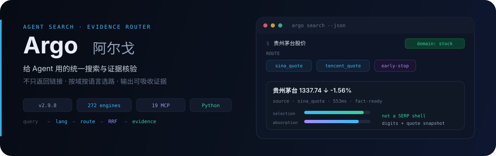
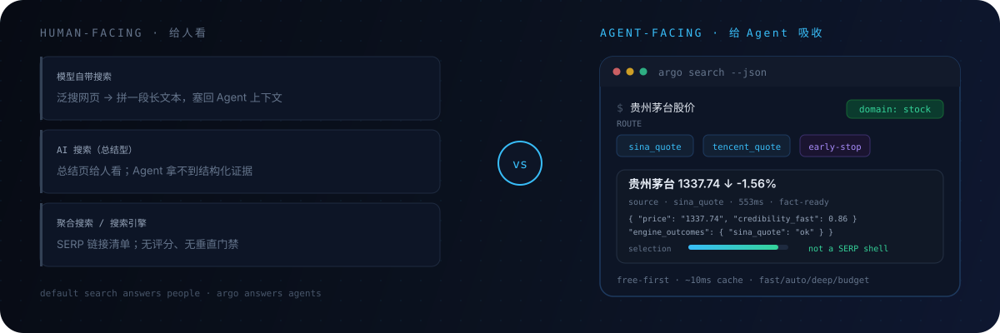
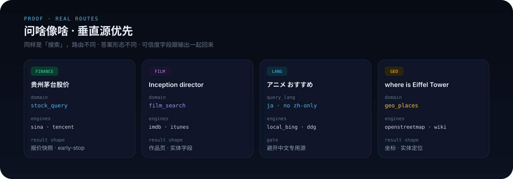
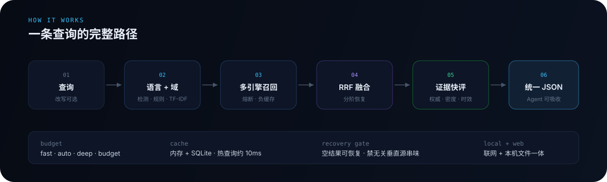

<p align="center">
  
</p>

<p align="center">
  <a href="README.md">中文</a> ·
  <a href="README.en.md">English</a> ·
  <a href="README.ja.md">日本語</a> ·
  <strong>한국어</strong> ·
  <a href="README.es.md">Español</a>
</p>

<p align="center">
  <a href="#무엇인가">소개</a> ·
  <a href="#모델-내장-검색--ai-검색--메타검색보다-강한-점">비교</a> ·
  <a href="#질문-형태에-맞는-라우팅">증명</a> ·
  <a href="#동작-방식">메커니즘</a> ·
  <a href="#빠른-시작">빠른 시작</a> ·
  <a href="#기능">기능</a> ·
  <a href="#설치와-설정">설정</a> ·
  <a href="#최근-업데이트">업데이트</a>
</p>

<p align="center">
  
  
  
  
  
</p>

> **이 저장소는 taxueseek의 DeepSeek Harness 플러그인 라인업 중 하나**입니다（[dsh-files](https://github.com/taxueseek/dsh-files) 39★）. 같은 저자 스킬 시리즈: [session-digger](https://github.com/taxueseek/session-digger) 29★ · [taxue-invest](https://github.com/taxueseek/taxue-invest) 21★ · [taxueskills](https://github.com/taxueseek/taxueskills) 23★ · [taxue-creative-style](https://github.com/taxueseek/taxue-creative-style) 12★

# Argo 아르고: 에이전트를 위한 검색과 심층 리서치 도구

## 무엇인가

**Argo는 에이전트에 설치하는 검색·심층 리서치 도구이며, 관련 웹페이지의 정보도 가져올 수 있습니다. 뒤에는 278개의 검색 소스가 있고 98개 업무 영역을 커버하며, 로컬 파일 기본 검색도 지원합니다. 오픈소스 검색 프로젝트 가운데 매우 강력한 검색 능력을 갖췄습니다.**

API Key를 설정하면 검색 품질이 올라갑니다(키가 있는 소스는 보통 더 좋고, 없으면 자동으로 건너뜀). 무료 엔진과 로컬 엔진이 자동으로 보루 역할을 합니다. 중국어·영어·일본어·한국어 등 18개 언어를 커버하고, 금융·학술·영화·스포츠·코드·매크로 같은 수직 시나리오를 지원합니다.

## 하위 스킬

Argo의 능력은 네 개의 하위 스킬(sub-skills)로 구성되며, 각 하위 스킬은 독립적으로 쓸 수 있는 파이프라인입니다:

| 하위 스킬 | 능력 |
|--------|------|
| **local-search** | 로컬 파일 검색 + 로컬 제로 비용 집계 엔진(로컬 엔진 32개). 코드 심볼, 파일명, 문서 전문, 파일 구조 검색. 네트워크 검색 결과에 합칠 수 있고, 스위치 하나면 로컬 적중이 같은 검색에 함께 들어감 |
| **local-seek** | 로컬 시맨틱 검색(BM25 + 벡터 하이브리드), 노트·메모리·자료실 검색. 3단계 점진: 파일 위치 확인 → 문맥 확인 → 단락 정독 |
| **ego-search** | 로그인 상태 전문 검색. 지후, 샤오홍슈, 위챗 공식계정처럼 로그인해야 볼 수 있는 콘텐츠를 실제 브라우저와 로그인 상태로 검색. 기본 꺼짐, 필요할 때 켬 |
| **js-run** | 브라우저 없이 웹 JS 실행. 브라우저를 열지 않고 「환경 탐지 + 순수 계산」형 웹 스크립트를 실행, 단일 컨텍스트 P50 약 1ms |

네 하위 스킬이 「로컬 검색」에서 「웹 전체 검색」, 「로그인 벽 뒤 검색」까지 전 체인을 커버합니다. 대부분은 local-search + 네트워크 검색이면 충분하고, 특수한 경우에 ego-search와 js-run을 켜면 됩니다.

## DSH 플러그인

Argo는 DeepSeek Harness 플러그인이기도 하며, 명령 한 줄로 설치합니다:

```bash
dsh plugin --profile web add argo-search                  # npm 릴리스판
dsh plugin --profile web add "github:taxueseek/argo"      # GitHub main
```

설치 후 `dsh web`을 재시작하면 적용됩니다. 검색과 긁기가 네이티브 1급 도구가 되어 MCP 연결에 의존하지 않고 상주 컨텍스트 비용도 차지하지 않습니다. 그 외 `wide_research` 병렬 리서치 1개와 MCP 도구 19개를 필요할 때 켤 수 있습니다. 전체 연동 형태는 아래에서.

### 세 가지 호출 채널, 하나의 기능 세트

같은 argo 검색 코어(같은 엔진, 같은 압축, 같은 가드)가 DSH 안에서 세 개의 채널을 열고, 호스트 능력에 따라 자동으로 다운그레이드되며 서로를 백업합니다:

| 채널 | 기본값 | 동작 |
|------|--------|------|
| **네이티브 1급 도구** | 켬 | `argo_search` / `argo_fetch` 등을 `ctx.tools.register`로 등록하고 CLI 단발(`--call`)로 실행합니다. MCP와 동일한 엔진·가드 스택을 재사용하므로 **MCP 연결 불필요, 상주 토큰 비용 0** |
| **네이티브 web seam** | 켬 | `argo`를 검색 프로바이더와 긁기 프로바이더 양쪽으로 등록해 호스트 내장 `web_search`는 argo 엔진 체인으로, `web_fetch`는 argo 긁기 체인으로 라우팅합니다(HTTP 우선, Cloudflare / JS 렌더링에서는 자동으로 안티 디텍션 브라우저로 승격) |
| **MCP 형태** | 필요 시 | 19개 `mcp__argo__*` 전체 도구 면. 도구 정의는 매 라운드 컨텍스트에 주입되며 압축해도 지워지지 않습니다(19개 도구 실측 ≈3.7K 토큰/라운드). 반면 고빈도 경로는 네이티브 도구와 web seam이 이미 커버하므로 기본적으로 마운트하지 않습니다. 롱테일 포렌식 도구가 필요할 때 profile patch의 `mcp-argo` 줄 주석을 해제하세요 |

그 외 `wide_research`가 1개 있습니다: 보완적인 트랙을 계획(`depends_on`으로 단계화, 기본은 병렬) → 유계 병렬 서브에이전트로 증거 수집 → 출처 장부(http(s) URL만 기록) → 종합 보고서. 출력에는 `quality_gate_results`(`conclusion_cap`: low/medium/high)가 붙고, `passed=false`일 때는 표현을 낮추고 결론 전에 장부의 출처를 검증합니다. worker 증거 도구 허용 목록은 MCP 이름과 네이티브 이름을 둘 다 쓰므로(allow 의미) MCP 마운트 여부와 무관하게 동작합니다. MCP가 있으면 전체 면을 쓰고, 없으면 `argo_search` / `argo_fetch`와 호스트의 `web_search` / `web_fetch`로 떨어집니다.

일상적인 질문에는 `argo_search`, 단일 에이전트 포렌식에는 `argo_research`, 인용 장부가 필요한 다각적 비교에는 `wide_research`를 나눠 씁니다. worker는 기본적으로 argo 증거 도구만 호출할 수 있고 `argo_research`를 다시 호출할 수 없습니다(하드 가드 — 사용자 계층의 放行도 무효).

### 내장 설정 페이지: 여섯 개 구역, 저장 즉시 적용

플러그인에는 브라우저 측 설정 페이지가 내장되어 있고 입구는 두 곳입니다: 설정 팝업(`Cmd+,`)의 왼쪽 메뉴 항목 "Argo", 또는 설정 > 플러그인 > Argo(같은 패널의 요약 카드, 클릭하면 열립니다).

<p align="center">
  
</p>

<p align="center">
  
</p>

<p align="center">
  
</p>

| 구역 | 관리 내용 |
|------|-----------|
| **接入** | `web_search` / `web_fetch` seam 전환. 엔진 실행 명령과 인자(npx 또는 로컬 `mcp_server.py`). 검색/긁기 타임아웃, 본문 상한, 유휴 연결 회수, 동시 연결 수 |
| **도구** | 18개 네이티브 1급 도구 체크(기본은 `argo_search` / `argo_fetch`만). 단발 호출 타임아웃과 반환 텍스트 상한 |
| **引擎** | argo 본체의 동작 스위치(기존에는 환경 변수, 큐레이션된 허용 목록 28개: 캐시 / TF-IDF 재순위 / 수치 교차 검증 / MinHash 중복 제거 / SERP 가드, Jina / 모바일 UA / Parallel 긁기 계층, 의미 증거 계층, 헤지 여유와 꼬리 폭, 엔진 활성화 목록, 프록시, 로컬 검색 루트와 읽기 허용 목록, 웜업 / 사용 로그 / 연결 풀 / 각종 TTL). 스위치류는 즉시 반영, 숫자·텍스트·목록류는 그룹 저장. 미설정 행은 argo 기본값을 표시하고 "默认"로 표기. 인가 계열 스위치(재계산 실행, 인트라넷 URL)는 의도적으로 패널에 넣지 않습니다 |
| **密钥** | 주요 엔진 키의 입력·갱신·삭제. "설정됨 / 미설정 + 출처 계층(凭证库 / 시작 환경 / .env) + 읽기 전용 상태"를 표시하고 평문은 표시하지 않습니다. 각 행의 "전달" 체크는 참조 이름을 `keyRefs`에 추가하는 것과 동일합니다 |
| **研究** | worker / 트랙 / 트랙당 출처 / 토큰 상한과 보고서 출력 디렉터리 |
| **高级** | worker 도구 allow / deny 목록, 凭证 전달 목록 |

저장은 즉시 적용됩니다(모두 volatile 설정): 네이티브 도구 세트는 체크에 따라 등록·해제되고, 타임아웃·동시성·연구 상한은 다음 호출 때 읽힙니다. 엔진 스위치는 `argoEnv`(한 줄에 하나의 `KEY=VALUE`)로 argo 서브프로세스 env에 들어가 다음 신규 연결부터 적용됩니다(풀의 오래된 연결은 `searchIdleMs`로 회수, 기본 60초). 구조적 필드(`toolName`, `provider`, `searchProviderId`, `fetchProviderId`)는 설정 페이지에 없고 여전히 profile patch를 거치므로 변경 후 재시작이 필요합니다.

**키 보안**: 키는 DSH 凭证库(Models 페이지와 같은 곳)에 쓰이며 플러그인 설정에는 쓰이지 않고, 로그에도 남지 않으며 평문도 표시하지 않습니다. 凭证 해석 우선순위는 **저장 파일 계층 > 시작 환경 > 프로젝트 .env > 홈 .env**이며, 패널(또는 Models 페이지)에서 저장하면 시작 환경의 오래된 값을 덮어쓰고 argo 서브프로세스는 다음 신규 연결에서 새 키를 받습니다. "삭제"는 凭证库 값만 지우므로 환경 변수나 `.env`가 제공한 키는 다시 드러납니다. 설정 페이지는 凭证 도메인의 쓰기 입구일 뿐이며, 읽기는 호스트가 매 호출 때 수행합니다.

**DeepSeek 공식 키는 네이티브로 공급**: argo의 `deepseek_search` 엔진(공식 `api.deepseek.com/v1/tools/search`, 결과에 authority 권위 등급 / rerank_score / 게시 시각이 붙음)은 DSH 공식 검색 백엔드와 **같은 키를 공유**합니다. 플러그인은 DSH 네이티브 凭证 seam으로 가져오므로 수동 설정이 필요 없습니다. 해석은 `ctx.get('credentials').resolve('DEEPSEEK_API_KEY')`로 호출마다 이루어지며, web Models 페이지에서 키를 교체하면 다음 신규 연결에서 반영되고 플러그인 재시작도 필요 없습니다. 플러그인은 키 파일을 읽지 않고, 디스크에 쓰지 않으며, 로그에도 남기지 않습니다. 키 값은 메모리를 통해서만 argo 서브프로세스 env에 들어가며 출력이나 오류 메시지에 일절 포함되지 않습니다. credentials 서비스가 없는 구형 호스트에서는 조용히 건너뛰고, 해당 엔진은 키 부족으로 비활성화되며 나머지 263개 소스는 영향을 받지 않습니다.

**web seam pin은 필수 읽기입니다**(설정 누락 시 `web_fetch`가 깨집니다): 호스트 `dsh-web`의 프로바이더 선택 규칙은 "설정된 id가 우선. 미설정이고 사용 가능이 정확히 하나면 그것을 고름. **여러 개면 `WEB_PROVIDER_AMBIGUOUS`로 실패**". web profile은 기본으로 공식 http fetch 프로바이더(key 불필요, 항상 사용 가능)를 유지하고 이 번들이 하나를 더 등록하므로, pin이 없으면 사용 가능이 두 개가 되어 **`web_fetch`가 통째로 깨집니다**(profile에 다른 검색 프로바이더가 있으면 `web_search`도 마찬가지). 따라서 web seam을 활성화한 profile은 반드시 web 서비스 줄에 명시해야 합니다:

```yaml
- id: web
  config:
    searchProvider: argo    # 검색 seam이 활성화된 경우(기본 활성) 필수
    fetchProvider: argo     # 긁기 seam이 활성화된 경우(기본 활성) 필수
```

`searchProviderEnabled: false` / `fetchProviderEnabled: false`는 해당 seam을 통째로 끕니다(프로바이더는 등록된 채로 남지만 선택 불가, 다른 쪽에는 영향 없음). 엔진 쪽에서는 Firecrawl 같은 익명 사용 가능 엔진이 **키 없이 그대로 쓸 수 있고**(무료 계층 할당량), 키가 설정된 엔진은 자동으로 인증 요청으로 승격되며 키 부족은 라우팅을 막지 않습니다.

> 전체 설정 항목, Compatibility 버전 대응표, 제거 절차는 [packages/dsh-plugin/README.md](packages/dsh-plugin/README.md)에 있습니다.

## 핵심 강점

**278개 소스, 그중 241개는 키 없이 바로 사용.** API Key를 하나도 설정하지 않아도 돌아가고, 무료 엔진과 로컬 엔진이 자동으로 보루 역할을 합니다. 키가 있는 소스는 보통 더 좋고, 없으면 자동으로 건너뜁니다. 한 번 설치로 모든 시나리오를 커버합니다.

**로컬 검색 + 네트워크 검색 일체.** Argo만의 능력입니다. 로컬 파일 검색의 밑바탕은 rg, mdfind 같은 개발자 일상 도구로, 코드 심볼·파일명·문서 전문·파일 구조를 검색합니다. 스위치 하나면 로컬 적중이 같은 네트워크 검색 결과에 합쳐지고, 결과에는 출처가 로컬 파일이라고 표시됩니다. 글을 쓰다가 반년 전에 적어 둔 문단이 기억나는데 어디에 있는지 모를 때, 폴더를 뒤지는 것보다 이 검색이 빠릅니다.

**이중 캐시, 핫 쿼리 약 10ms.** 시의성이 약한 콘텐츠(백과류, 역사 데이터 등)는 첫 조회 후 캐시에 들어가고, 같은 쿼리는 바로 적중해 매번 API를 다시 타지 않습니다. 비용도 시간도 아낍니다.

**다국어 + 수직 시나리오.** 18개 언어를 실측했고, 중국어·영어·일본어는 현지 1차 소스를 찾습니다. 논문은 학술 DB, 영화는 작품 DB, 코드는 Q&A 커뮤니티, 시세는 금융 소스로 보냅니다. 두루뭉술한 질문만 일반 검색으로 갑니다.

## 설치하면 바로 사용

설정 없이 바로 돌아갑니다. 설치 방법 세 가지, 취향대로 고르세요:

**AI 어시스턴트가 스스로 검색하게 하고 싶다면**, 스킬 패키지를 그 스킬 디렉터리에 넣으세요. 이후 「좀 찾아봐」「확인해봐」라고 하면 알아서 검색합니다.

**가볍게 시험해보고 싶다면**, npx 명령 한 줄로 설치 없이 바로 씁니다.

**어시스턴트에 상주시키고 싶다면**, MCP를 붙이면 19개 검색 도구를 언제든 쓸 수 있습니다. 원클릭 주입 명령도 있어 Claude Code, Cursor, Windsurf에 자동으로 설정해 주며, Codex, OpenCode, Cline도 이 목록에 있습니다. 설정을 쓰기 전에 백업하므로 언제든 되돌릴 수 있습니다.

```bash
# 방식 1: 원클릭 스크립트(로컬 장기 사용 권장)
curl -fsSL https://raw.githubusercontent.com/taxueseek/argo/main/scripts/install.sh | bash

# 방식 2: npm / npx(지원됨, 현재 2.9.9, tag마다 배포·버전 고정)
npm install -g argo-search       # CLI 전역 설치
npx -y argo-search               # 또는 설치 없이 즉시 사용
npx -y github:taxueseek/argo     # main 최신 커밋을 따라가려면 이 명령

# 방식 3: git clone(개발 / 소스 수정)
git clone https://github.com/taxueseek/argo.git
```

설치 후 바로 한 번 시험:

```bash
argo search "python asyncio error handling"
```

StackOverflow 공식 API에서 커뮤니티 점수로 정렬되고 채택 상태가 표시된 질문을 줍니다. SEO 팜이 아닙니다.

내 컴퓨터에서 지금 쓸 수 있는 소스가 몇 개인지 보고 싶다면, 명령 한 줄이면 목록이 나옵니다:

```bash
argo search --list-engines
```

## 연동 형태

Argo는 네 가지 연동 방식을 지원합니다. 시나리오에 맞게 고르세요:

| 형태 | 적합 | 설명 |
|------|------|------|
| **MCP Server** | 에이전트 상주 마운트 | 19개 검색 도구를 언제든 사용, 명령 한 줄로 Claude Code / Cursor / Windsurf / Codex / OpenCode / Cline에 주입, 설정 작성 전 자동 백업 |
| **DSH 플러그인** | DeepSeek Harness 사용자 | `dsh plugin add` 한 줄로 설치, 검색과 긁기가 네이티브 1급 도구가 되어 MCP 연결에 의존하지 않고 상주 컨텍스트도 차지하지 않음. 저장 즉시 적용되는 6개 구역 설정 페이지 내장 |
| **Skill 파일** | Claude Code / Grok Build / Kimi 등 | 스킬 패키지를 에이전트의 스킬 디렉터리에 넣으면 「좀 찾아봐」「확인해봐」에 알아서 검색 |
| **npx 즉시 사용** | 빠르게 시험 | `npx -y argo-search`(npm 릴리스판) 또는 `npx -y github:taxueseek/argo`(main), 설치 없이 임시로 아무 클라이언트에 MCP를 붙이기 좋음 |

네 가지 형태의 밑바탕은 같은 Python 코드이며, CLI와 MCP 도구는 일대일로 대응하므로 어느 형태로 설치해도 능력이 빠지지 않습니다.

## 모델 내장 검색 / AI 검색 / 메타검색보다 강한 점

> 간단히: 앞의 세 가지는 **사람**이 정보를 찾게 돕습니다. Argo는 **에이전트**가 검색과 검증을 한 파이프라인에서 하게 합니다. 차이는 UI가 아니라 산출물 — 사람용 요약 페이지·링크 목록 대, 에이전트가 정렬하고 `fetch`로 재확인하고 컨텍스트를 안 터뜨리는 증거.

<p align="center">
  
</p>

| 차원 | 모델 내장 검색 | AI 검색(요약형) | 메타검색 / 검색 엔진 | **Argo** |
|------|----------------|-----------------|----------------------|----------|
| 결과 형태 | 이어 붙인 장문 | 사람용 요약 페이지 | SERP 링크 목록 | **압축 JSON: 증거 후보 + 신뢰도 분해** |
| 수직 질문(시세 / 화학식) | 일반 웹 | 일반 웹 후 요약 | 일반 웹 | **수직 소스 직결, 답형 결과** |
| 증거 신뢰도 | 점수 없음 | 구조화 점수 없음 | 점수 없음 | **selection · absorption · freshness · 합의** |
| 반복 질의 | 매번 네트워크 | 매번 네트워크 | 페이지 캐시 | **이중 캐시(메모리 + SQLite), 핫 쿼리 약 10ms** |
| 비용 제어 | 제어 불가 | 호출당 비쌈 | 무료지만 수고 | **예산 모드, 무료 우선, 키는 모두 선택** |
| 다국어 | 모델을 따름 | 모델을 따름 | 엔진을 따름 | **언어 감지 + 엔진 로케일 파라미터 + 다국어 라우팅** |

> 메커니즘상 Argo는 검색을 **증거 파이프라인**으로 다룹니다: 언어 감지 → 도메인 라우트 → 다중 엔진 회수 → RRF 융합 → 증거 속평. 에이전트가 정렬하고, `fetch`로 확인하고, 컨텍스트 안에 넣을 재료를 줍니다.

---

## 2026년 검색에서 바뀐 것

1. **링크에서 증거로.** 에이전트는 정렬·검증 가능하고 컨텍스트에 맞는 구조화 자료가 필요 — Argo는 신뢰도 분해 JSON을 반환.
2. **컨텍스트가 첫 번째 비용.** 에이전트 프로필은 회당 약 3.7KB, 필드와 바이트 예산은 게이트로 고정.
3. **사이트들이 AI용 콘텐츠를 준비.** llms.txt와 `.md` 직접 출력이 확산 — fetch 체인이 레벨 0에서 자동 탐지, r.jina.ai 리더가 fallback.
4. **무료 오픈 생태계로 충분.** 정부·학술·표준·보안 공개 API와 키리스 엔진이 대부분 도메인을 커버 (무설정 241개).
5. **품질은 측정 가능.** 랭킹 골든 플로어, 융합 이득 어블레이션 게이트, 음의 라우팅 제어.

> 위 다섯 항목은 이미 v2.9.x 계열에서 모두 구현되었습니다: 278 소스 / 98 도메인 / 241 무설정.

---

## 질문 형태에 맞는 라우팅

<p align="center">
  
</p>

| 이렇게 물으면 | 대개 일어나는 일 |
|---------|----------------------|
| python asyncio error handling | 코딩 QA 도메인 → StackOverflow/StackExchange 공식 API, 점수·채택 마커 포함 |
| AAPL / US pre-market | 미국 주식 도메인, A주와 분리 |
| 肖申克的救赎 主演 / Inception director | 영화 도메인 → IMDb 등 |
| 梅西 俱乐部 / 库里 球队 | 스포츠 도메인 → TheSportsDB 등 |
| 埃菲尔铁塔在哪 / where is Eiffel Tower | 지리 엔티티 → OpenStreetMap 등 |
| NASA founding year / 国务院职能 | 조직 엔티티 → Wikidata 등 |
| 周杰伦 专辑 / Taylor Swift album | 미디어 도메인 → iTunes 등 |
| アニメ おすすめ / 한국 영화 추천 | JA/KO 감지 → 언어 친화 소스, 중국어 전용 사이트 회피 |
| US CPI, 일본 인플레이션 | 매크로 도메인, 국가 분리 (자국 1차 소스 우선) |
| log4j CVSS / nodejs 22 end of life | 보안 → NVD 공식; 수명주기 → endoflife.date |
| attention is all you need | 학술 → arXiv/OpenAlex/CrossRef 메타데이터 및 DOI 링크 |
| 阿司匹林 分子式 | 화학 → PubChem 계열 답 |
| TSMC valuation debate (deep research) | 하위 질문 + 병렬 소스, 수직 소스 가중 |

---

## 동작 방식

<p align="center">
  
</p>

```
query
  ├─ intent clarify (optional)
  ├─ query rewrite (optional; routing still sees original intent)
  ├─ language detect + language preference
  ├─ route (domain rules + TF-IDF + budget + lang supplements + hot-path cache)
  ├─ multi-engine recall (circuit breaker / negative cache / parallel)
  ├─ staged empty-result recovery (widen → same family/general → cross-lang; anti-pollution)
  ├─ RRF fusion + optional re-rank
  ├─ evidence skim (authority · density · freshness · consensus)
  └─ unified JSON (incl. engine_outcomes / recovery)
```

### 증거 점수 (요약)

```
selection  ≈ domain authority; SERP / redirect shells ranked very low
absorption ≈ density of numbers / definitions / comparisons / disclosures
freshness  ≈ publish time (ignores historical comparison years like “since 2015”)
composite  ≈ 0.40·selection + 0.35·absorption + 0.15·freshness + 0.10·engine score
```

결과에 `selection`, `absorption`, `credibility_fast`, `evidence_flags` 등이 포함되어 에이전트가 바로 정렬할 수 있습니다.

### 에이전트 규율 (권장)

1. **고위험 질문**(포지션, 안전, 「이게 사실인가?」): 검색 → 빠른 점수 확인 → 상위 결과 `fetch` → 그다음 결론  
2. **숫자**: 计算方式(정의·범위)을 밝히고, 소스가 충돌하면 나열—억지로 합치지 않기  
3. **SERP / 리다이렉트 페이지**: 1차 출처로 취급하지 않기  
4. **소셜 포스트**: 감성과 서사, 최종 사실 근거가 아님  
5. **팩트체크**: 층위별 소수 쿼리 선호(출처 / 비교 / 대상)

---

## 빠른 시작

경로를 고르면 됩니다. **npm 설치를 지원하며 최신 버전은 2.9.9**, GitHub와 마찬가지로 이 저장소에서 배포합니다. npm 경로는 `npm install -g argo-search` 또는 `npx -y argo-search`로 tag마다 배포되어 버전이 고정되고 다운로드도 작습니다. GitHub 경로는 `install.sh` / `install.ps1` 또는 `npx github:taxueseek/argo`로 main을 따릅니다. 앞으로는 tag를 만들 때마다 CI가 npm 두 패키지와 GitHub Release를 함께 배포합니다. registry의 낡은 v1.0.1은 역사 버전이니 고정하지 마세요.

**제로 설정으로 동작**: API 키 없이도 무료 엔진 + 로컬 `local_*` 엔진이 돌고, 키 없는 엔진은 스킵됩니다(키가 있으면 보통 더 좋습니다).

### 옵션 1: 설치 스크립트 (장기 로컬 사용에 적합)

```bash
curl -fsSL https://raw.githubusercontent.com/taxueseek/argo/main/scripts/install.sh | bash
```

홈 경로 + Skill 링크 지정:

```bash
curl -fsSL https://raw.githubusercontent.com/taxueseek/argo/main/scripts/install.sh \
  | bash -s -- --home "$HOME/.local/share/argo" --link "$HOME/.claude/skills/argo"
```

확인:

```bash
python3 ~/.local/share/argo/scripts/search.py "python asyncio error handling" --json
python3 ~/.local/share/argo/scripts/search.py --list-engines
```

### 옵션 2: GitHub MCP (에이전트에 빠르게 붙이기)

**Node.js 18+** 와 **Python 3.9+** 필요. 한 번:

```bash
pip3 install pyyaml
```

```bash
npx -y github:taxueseek/argo
```

클라이언트 설정 (Claude Code / Cursor / Kimi 등):

```json
{
  "mcpServers": {
    "argo": {
      "command": "npx",
      "args": ["-y", "github:taxueseek/argo"]
    }
  }
}
```

더 안정적·Node 불필요: 옵션 1로 설치 후 로컬 Python 지정:

```json
{
  "mcpServers": {
    "argo": {
      "command": "python3",
      "args": ["/path/to/argo/scripts/mcp_server.py"]
    }
  }
}
```

비표준 Python 경로: `export ARGO_PYTHON=/path/to/python3` (npx 진입점만 읽음).

### DeepSeek Harness 한 줄 플러그인

DeepSeek Harness에는 두 가지 설치:

```bash
# A: mcp__argo__* 도구 19개 (메인 패키지 bundle, MCP 전량과 동일)
dsh plugin --profile web add argo-search                  # npm 릴리스판
dsh plugin --profile web add "github:taxueseek/argo"      # GitHub main

# B: 검색 도구 + wide_research 병렬 연구 오케스트레이션 (서브패키지)
dsh plugin --profile web add @taxueseek/argo-dsh          # npm 릴리스판
dsh plugin --profile web add "github:taxueseek/argo#main&path:packages/dsh-plugin"
```

설치 후 `dsh web`을 재시작. 자세한 내용은 `packages/dsh-plugin/`.

### 옵션 3: 릴리스 tarball

[Releases](https://github.com/taxueseek/argo/releases)에서 최신 **`argo-x.y.z.tar.gz`** 다운로드(`x.y.z`는 최신 릴리스 번호로 바꿔 읽기):

```bash
tar -xzf argo-x.y.z.tar.gz
cd argo-x.y.z
pip3 install pyyaml
python3 scripts/search.py "Python asyncio" --json
python3 scripts/mcp_server.py
```

### 옵션 4: git clone (개발 / 소스 패치)

```bash
git clone https://github.com/taxueseek/argo.git
cd argo
pip3 install pyyaml
bash scripts/install.sh --link ~/.claude/skills/argo   # optional
python3 scripts/search.py --list-engines
```

### 옵션 5: Skill 디렉터리 (심볼릭 링크, 단일 진원)

```bash
python3 scripts/link_source.py --to ~/.claude/skills/argo
python3 scripts/link_source.py --to ~/.agents/skills/argo

cp installs.local.yaml.example installs.local.yaml
python3 scripts/link_source.py
python3 scripts/link_source.py --check
```

### 옵션 6: Python 라이브러리

```python
import sys
sys.path.insert(0, "/path/to/argo/scripts")
from search import super_search

result = super_search("Python asyncio", n=5, mode="fast")
for item in result["results"]:
    print(item["title"], item.get("credibility_fast"), item["url"])
```

```bash
# if bin/argo is on PATH
argo search "Python asyncio"
argo research "2026 mutual fund holdings structure"
argo evidence "a claim to verify"
```

---

## 플랫폼

| 플랫폼 | 연동 | 비고 |
|----------|-------------|-------|
| **Claude Code** | MCP / Skill 링크 | `npx` 또는 `mcp_server.py`; `link_source.py` 가능 |
| **Kimi / Grok Build** | MCP Server | 동일 |
| **Cursor / Cline / Continue** | MCP | MCP 지원 IDE 플러그인 |
| **CLI** | `search.py` / `bin/argo` | 스크립트, cron, 수동 디버그 |
| **Python 프로젝트** | `from search import super_search` | 라이브러리 호출 |

### 설치 후 점검

```bash
python3 --version          # 3.9+
python3 -c "import yaml; print('PyYAML OK')"
python3 -m pytest tests/test_unit.py -q   # optional
python3 scripts/search.py --list-engines
```

---

## 기능

| 기능 | 하는 일 | 진입점 |
|------------|--------------|-------|
| 통합 검색 | route → recall → fuse → skim score | `search.py` / `argo_search` |
| 로컬 파일 검색 | 디스크 코드/노트/메모리 (오프라인) | `argo_local_search` |
| 로컬 텍스트 미리보기 | 화이트리스트 디렉터리 미리보기 (fail-closed) | `argo_local_read` |
| 재계산 | 제한 서브프로세스 수치 재계산 (기본 거부) | `argo_recompute` |
| 심층 연구 | 하위 질문, 다중 소스, 갭 힌트 | `research.py` / `argo_research` |
| 신뢰도 | 권위 / 밀도 / 시의성 / 교차 검증 | `evidence.py` / `argo_evidence` |
| 의도 명확화 | 다의어, 브랜드 충돌, 전략 힌트 | `clarify.py` / `argo_clarify` |
| 페이지 가져오기 | HTTP 우선, 필요 시 브라우저 폴백 | `argo_fetch` (`mode=extract` 구조 추출) |
| 스크린샷 / PDF | 페이지 캡처, 구조화 PDF 추출 | `argo_screenshot` / `argo_pdf` |
| 사이트 크롤 | 목록 페이지 배치 크롤 | `argo_crawl` |
| 쿼리 연산자 | `site:` / `-site:` / `-단어` / `-"구문"` / `"구문"` / `lang:` / `after:` / `before:` 를 라우팅과 검색 양쪽에서 분리(상세는 references/usage.md) | 쿼리에 직접 기재 |
| 신뢰 신호 | `authority_level` 이산 등급(0-4, ≥3이면极高权威) + `summary` 에이전트용 요약(검증 후 역채움) | 결과 필드, `--fields agent` 로 표시 |
| 소셜 / 감성 | Weibo / Xiaohongshu / Bilibili / Reddit / X … | `argo_social_search` |
| DSH 네이티브 도구 | DSH 플러그인으로 설치하면 `argo_search` / `argo_fetch` 등이 호스트 1급 도구가 되어 CLI 단발로 실행, 상주 토큰 오버헤드 0 | `dsh plugin add` 후 직접 호출 |
| DSH web seam | 호스트 내장 `web_search` / `web_fetch`가 argo의 엔진·긁기 체인으로 라우팅(HTTP 우선, Cloudflare / JS 렌더링 시 자동 브라우저 승격) | 플러그인이 기본 등록, profile에서 `searchProvider` / `fetchProvider` pin |
| DSH 설정 페이지 | 接入 / 도구 / 引擎 / 密钥 / 研究 / 高级 6개 구역, 저장 즉시 적용. 키는 호스트 凭证库에, 평문 비표시 | 설정 팝업 `Cmd+,` → 왼쪽 메뉴 "Argo" |

### 예산 모드

| 모드 | 적합한 경우 | 동작 |
|------|----------|----------|
| `fast` | 단순 Q, 속도 필요 | 무료 엔진 우선, 유료 re-rank 스킵 |
| `auto` | 일상 기본 | 비용 인식 품질/지출 트레이드오프 |
| `deep` | 연구, 조사 | 품질 우선, 엔진 더 허용 |
| `budget` | 할당량 타이트 | 쿼터 제어, 소진 시 저하 |

### 대략적인 능력 세트 (v2.9.9)

Argo가 하는 일을 한 줄로 말하면, 질문을 도메인과 언어로 알맞은 소스에 보내고, 돌아온 결과를 신뢰도로 줄세워, 에이전트에는 줄세우고 검증할 수 있는 재료를 넘긴다. 검색·긁기·증거 확인·로컬 파일 검색은 같은 파이프라인을 흐르고, 19개 MCP 도구는 CLI 명령과 일대일로 대응하므로 어떤 형태로 설치해도 능력이 빠지지 않는다. 단독 명령도 몇 개 있다: argo tweet은 X 게시물을 묶고, argo auth는 로그인 상태를 관리하며, argo job은 채용 정보를 모은다. 전체 소스의 비용·키·상태는 docs/ENGINE_CATALOG.md에 있다: 278 소스, 241 무설정, 98 도메인.

DSH 플러그인으로 설치하면 이 능력들이 호스트의 네이티브 도구가 된다. 고빈도 검색과 긁기는 기본으로 켜져 있고, 롱테일 포렌식은 설정 페이지에서 필요에 따라 체크하며, argo 본체의 28개 동작 스위치(캐시, 재순위, 중복 제거, 가드, 프록시, TTL 등)는 환경 변수에서 패널로 옮겨졌다. 키는 호스트 凭证库에 들어가고, 평문은 표시되지 않으며, 모든 변경은 저장 즉시 적용된다.

최근 몇 판이 각자 한 부류의 문제를 고쳤다.

v2.9.9는 보안과 제공 품질의 판이다. 콘텐츠 보안 엔진은 채점만 하고 막지 않아 고위험 주입 페이지가 그대로 컨텍스트에 들어갔다. 이제 임계값을 넘으면 격리하고, 세척된 본문으로 갈아치우며, 증거 점수에도 들어가지 않는다. 네트워크 출구에는 두 겹의 방어가 더해졌다. 리다이렉트는 홉마다 검증하고, DNS 해석 결과는 해당 연결에 못 박는다. 디스패치 쪽에서는 조기 중단으로 버려진 느린 엔진의 결과를 더 이상 버리지 않는다. 백그라운드에서 회수하고, 유예 시간 안에 끝나면 평소처럼 제공하며 학습기에 실제 성적을 기록한다. 라우팅은 여섯 부류의 실전 시나리오 스캔으로 다섯 부류의 오라우팅을 거뒀다. A주 금융 쿼리, 기업 듀딜리전스/개표/사람으로 회사 찾기, 민사 실무, 약 설명서, 논문 작성 하우투가 제자리를 찾는다. 이번 판에 argo engine add로 새 엔진을 한 단계에 붙일 수 있고, DSH 설정 페이지에는 라우팅 관측 카드와 도구 추천 조합이 생겼다.

v2.9.8은 라우팅 정밀도와 피드백 루프를 닫는 버전입니다. issue #18의 세 가지 —「latest」가 실시간 뉴스로 잘못 분류됨, people_daily가 일치하지 않을 때 기본 feed를 반환함, local_bing이 「2026」만 매칭함 — 을 모두 재현해 고쳤습니다. 같은 관점으로 실제 쿼리를 재생해 16개 클래스의 오탐을 더 좁혔습니다. 브랜드명 속 「눈」, 제품명 속 「火山引擎」, UI 트러블슈팅의 「아이콘」, 상공/금융 필드의 「코드」, 코드 문맥의 「환율」 등입니다. SERP 커버리지 게이트와 CJK 교차 검증도 넣어 「결과가 나왔다=관련 있다」로 끝나지 않게 했습니다. 재현과 진단을 도와준 @wpp666에게 감사합니다.

v2.9.7이 고친 것은 세 개의 오래된 병이다. DSH 호스트 안의 AI가 URL을 읽을 때 호스트 자체 긁기를 써서 단축 링크 점프·JS 챌린지 페이지가 구조적으로 실패하기 일쑤였고, argo의 긁기 체인은 쓸 일이 없었다; 이 판에 호스트 읽기가 argo를 흘러 그런 페이지가 실패→성공으로 바뀌고, 일반 페이지는 그대로다. 라우팅 후보 풀에 명시 전용 18개 엔진이 섞여 자동 선택되면 유일한 유료 엔진이 조용히 과금될 위험이 있었는데, 지금은 후보 풀에 없고 쓰려면 명시해야 한다. 엔진이 성공할 때마다 회로 차단기가 파일 잠금으로 디스크를 다시 썼는데, 건강 상태에서는 파일 오버헤드가 제로이고 다중 엔진 부기도 한 트랜잭션에 합쳐진다. License도 MIT에서 Apache-2.0으로 바뀌어 상용 이용이 한결 편해졌다.

그 후 DSH 플러그인에 또 한 층이 더해졌다. 설정 페이지는 다섯 구역에서 여섯 구역으로 늘었고, 새 「引擎」 구역이 argo 본체의 동작 스위치를 패널에 담았다(기존에는 환경 변수뿐). 키 페이지에서는 각 키가 凭证库, 시작 환경, `.env` 중 어디에서 오는지 보이게 됐고, 도구 체크·타임아웃·동시성·연구 상한은 모두 저장 즉시 적용된다. 취소도 연결 수립 단계까지 도달해, AI가 중간에 멈추면 아직 뜨고 있는 argo 서브프로세스는 타임아웃을 기다리지 않고 즉시 죽는다.

v2.9.6이 맡은 것은 쿼리 연산자와 전송층이다. 「site:github.com 뭐뭐」식 질의는 연산자가 일반 단어로 다뤄지거나解析만 되고過滤는 안 됐는데, 계약층이 생겨 라우트와 캐시는 벗긴 질의만 인식하고 site:는 진짜 후치 필터로 실행되어 캐시 키에도 들어가 두 번의 검색이 섞이지 않는다. 전송층에서는 POST마다 TLS 핸드셰이크(320~561 ms)를 다시 지불했는데, 연결 풀링으로 상주 MCP 프로세스는 매 질의마다 이를 아낀다. 이 판에 공식 DeepSeek 검색이 들어갔고, 종량 과금에 일상 combo에는 안 든다.

v2.9.5에서 더해진 것은 환율과 중복 제거 정화다. 「위안/달러 환율」을 물으면 거시 도메인을 돌아 백과사전 표제어에 착륙해 1.4초 만에 답이 없었는데, 환율 전용 도메인이 생겨 675 ms에 즉시 환율과 매일 뉴스를 돌려준다. 중복 제거에 접미사 정규화와 퍼지 재확인이 더해져 제목에 구분자 있는 공식 문서가 후방으로 밀리는 일이 없어졌다.

v2.9.4가 고친 것은 명시 엔진 지정 경로다. --engine X를 지정하면 캐시 TTL이 일률이었는데, 도메인 판정이 들어가 TTL은 도메인을 따르고, 예비 엔진이 없으면 같은 엔진의 공회전도 하지 않는다.

판별 상세는 「최근 업데이트」에, 각 판 릴리스 노트는 docs/에 있다.
---

## 엔진과 라우팅

설정에는 현재 **278** 소스(**241**개는 키 불필요)와 **98** 도메인이 있습니다 (`config.yaml`, `--list-engines` 참고).

### 직접·수직 (발췌)

| 엔진 | 시나리오 | 비용 성향 |
|--------|----------|-----------|
| anysearch / duckduckgo | 일반 / 기술 | free |
| sina_quote / tencent_quote / eastmoney | A주 시세 / 자금 흐름 | free |
| finviz / seeking_alpha | 미국·해외 금융 | depends |
| imdb / itunes / thesportsdb | 영화 / 음악 / 스포츠 | mostly free |
| local_openstreetmap / wikidata / wikipedia | 지리 / 조직 / 백과 | free |
| arxiv / semantic_scholar / openalex | 학술 | mostly free |
| pubchem / gbif / rfc_editor | 화학 / 종 / 표준 | free |
| github / stackoverflow / pypi / npm | 코드·패키지 | depends |
| byted / bocha / metaso / octen / yuanbao | 중국 웹 / AI 검색 | API / 저비용 |
| hkex / shfe / cfets / defillama / gleif | 홍콩 공시 / 상기소 / 위안화 중간가 / DeFi / 법인 식별자 | 무료 |
| zhihu / wechat_sogou | 중국 여론 / WeChat | API / free |
| tavily / felo / exa | 국제 / 시맨틱 | paid or quota |
| twitter / reddit / xiaohongshu / bilibili / weibo | 소셜 UGC | free (some need login) |

### 로컬 제로 비용 레이어 (`local_*`)

별도 SearXNG 서비스 불필요. 메인 경로는 프로세스 내 HTML / RSS / JSON 파싱 (`local_bing`, `local_sogou`, `local_google`, `local_arxiv`, …). **다국어 쿼리**에서는 라우팅이 엔진 언어 파라미터를 재작성(예: Bing `setlang`)하고 RRF로 융합합니다.

---

## 예시

### 금융

```bash
python3 scripts/search.py "python asyncio error handling" --explain
# typical: stock_query → quote snapshot sources
```

### 학술

```bash
python3 scripts/search.py "transformer attention mechanism paper" --json
# domain often academic; combo includes arxiv etc.
```

### 연구와 검증

```bash
python3 scripts/research.py "2026 mutual fund Q2 holdings structure" --depth deep --json

python3 scripts/search.py "same query" --json | \
  python3 scripts/evidence.py "same query" --stdin --json
```

### MCP 도구 (12)

| 도구 | 용도 |
|------|---------|
| `argo_search` | 통합 검색 |
| `argo_local_search` | 로컬 파일 (오프라인) |
| `argo_local_read` | 화이트리스트 로컬 텍스트 미리보기 (fail-closed) |
| `argo_recompute` | 제한 서브프로세스 재계산 (기본 거부, 인가 필요) |
| `argo_research` | 심층 연구 (소셜 감성 모드 포함) |
| `argo_evidence` | 신뢰도 점수 |
| `argo_clarify` | 의도 명확화 |
| `argo_fetch` | 스마트 fetch (`mode=extract` 구조 추출) |
| `argo_crawl` | 사이트 크롤 |
| `argo_screenshot` | 페이지 스크린샷 |
| `argo_pdf` | PDF 추출 |
| `argo_social_search` | 멀티 플랫폼 소셜 (`mode=sentiment`) |

---

## 설치와 설정

### 요구 사항

| 항목 | 요구 |
|------|-------------|
| Python | 3.9+ (CLI + MCP 코어) |
| 의존성 | `pip install pyyaml` (필수 의존성 하나) |
| Node.js | **`npx` 진입에만** 필요, 18+ |
| SearXNG | 불필요 (내장 로컬 엔진) |

### API 키 (모두 선택)

키가 없으면 해당 엔진 스킵, 무료 엔진이 버팀. **환경 변수 사용**—실제 키를 커밋하거나 이슈에 붙이지 마세요.

```bash
# recommended (better quality)
export TAVILY_API_KEY="your_key"
export BOCHA_API_KEY="your_key"
export METASO_API_KEY="your_key"
export ZHIHU_ACCESS_SECRET="your_key"

# optional
export BRAVE_API_KEY="your_key"
export FELO_API_KEY="your_key"
export GITHUB_TOKEN="your_key"
export WEB_SEARCH_API_KEY="your_key"
export ANYSEARCH_API_KEY="your_key"
export OCTEN_API_KEY="your_key"
export ARGO_KEENABLE_API_KEY="your_key"   # 선택; Keenable 무료 체험
```

`config.yaml`에는 `{ENV_NAME}` 플레이스홀더만—git에 평문 시크릿 없음.

### 캐시

기본 SQLite 경로는 `config.yaml`의 `cache.db_path` (보통 `~/.cache/unified-search/cache.db`).

| 유형 | 대략 TTL |
|------|-------------|
| Finance | ~5 min |
| News / realtime | ~10–15 min |
| General | ~1 hour |
| Research / evergreen | ~2–24 hours |
| Empty results | very short (avoid freezing “no hits”) |

### FAQ

**API 키 없이도 되나요?**  
네. 많은 로컬 무료 엔진과 무료 API; 키 없는 경로가 자동입니다.

**설치 스크립트 vs npx?**  
스크립트: 고정 로컬 설치, 설정, Skill 링크. npx: MCP를 빠르게 붙임. 같은 Python 코어.

**엔진 확인은?**  
`python3 scripts/search.py --list-engines`, 또는 `--explain` 추가.

**저장소에 코드 사본이 여러 개?**  
아니요. `link_source.py`로 단일 소스 + 심볼릭 링크를 권장, rsync 복제 지양.

---

## CLI 플래그

```
python3 scripts/search.py [options] query

  --engine, -e       engine, default auto
  --max-results, -n  count, default 5
  --depth, -d        fast | balanced | deep
  --mode             fast | auto | deep | budget
  --no-cache         skip cache
  --explain          print routing explanation
  --json             JSON output
  --timeout, -t      timeout seconds
  --list-engines     list engines
```

---

## 설계 트레이드오프

1. **에이전트 흡수 우선, 링크 개수 차선.**  
2. **무료·로컬 우선, 유료는 선택적 향상.**  
3. **실패는 관측 가능**: empty / timeout / breaker에 라벨—조용히 삼키지 않음.  
4. **설정 주도 엔진**; `config.yaml`이 단일 진원.  
5. **단일 소스 설치**: 링크 엔트리, rsync 복제 금지.  
6. **소셜은 진리 라이브러리가 아님**; 확장·감성에는 좋으나 유일한 사실 근거는 아님.

---

## 잘 맞는 경우

- Claude Code / Grok Build / Codex / Kimi 에이전트의 검색 백엔드  
- **다국어·다도메인** Q&A: CJK + EN + 금융 / 영화 / 스포츠 / 학술 / 코드  
- **재현 가능·캐시 가능** 검색이 필요한 스크립트와 파이프라인  
- 공개 금융 / 엔티티 데이터의 팩트체크와 다중 소스 비교  

단독 솔루션으로 덜 적합한 경우: 플랫폼 네이티브 인게이지먼트 랭킹, 또는 장기 max-recall 애그리게이터(내장 로컬 엔진이 외부 SearXNG 메인 경로를 대체).

---

## 트리 (요약)

```
argo/
├── README.md                # Chinese (default)
├── README.en.md             # English
├── README.ja.md             # Japanese
├── README.ko.md             # Korean
├── README.es.md             # Spanish
├── SKILL.md
├── package.json             # npx entry
├── bin/argo.js              # Node MCP launcher
├── bin/argo                 # Python CLI
├── config.yaml              # engines & domains (source of truth)
├── assets/readme/           # README visuals
├── backends/
├── mcp/                     # 다중 클라이언트 MCP 주입 진원 (clients.yaml)
├── scripts/                 # search / research / mcp / install …
├── sub-skills/local-search/
├── sub-skills/ego-search/      # 로그인 상태 전문 검색 (기본 꺼짐)
├── tests/
└── docs/
```

---

## 최근 업데이트

최근 세 버전만 싣습니다. 전체 이력은 [변경 이력](#변경-이력), 각 버전의 상세는 [Releases](https://github.com/taxueseek/argo/releases)에서 볼 수 있습니다.

### v2.9.9: 다층 보안 + 느린 소스 결과를 버리지 않음 + 오라우팅 다섯 부류 수습

- **고위험 본문은 컨텍스트에 들어가지 않습니다**: 콘텐츠 보안 엔진이 「채점만」에서 「격리+세척 치환」으로 올라갑니다. `risk_score ≥ 0.5` 본문은 세척본으로 대체되고 증거 점수에서 제외됩니다. 기본 활성, `ARGO_CONTENT_RISK_GATE=0`로 비상 해제
- **네트워크 출구 다층 방어**: 리다이렉트 홉별 검증(`ARGO_MAX_REDIRECTS`, 기본 5) + 해석 즉시 고정으로 DNS 리바인딩 창을 막습니다
- **조기 중단으로 버려진 느린 소스의 결과를 다시 버리지 않습니다**: 버려진 엔진은 백그라운드 회수로 넘어가고, `ARGO_TAIL_COMPLETE_S`(기본 3초, 0=끔) 안에 끝나면 평소처럼 제공되며 실제 성적이 학습기에 기록되고, 결과는 중복 제거해 캐시에 통합됩니다
- **오라우팅 다섯 부류 수습**: A주 금융 쿼리는 `stock_query`로, 기업 듀딜리전스/개표/사람으로 회사 찾기는 `company_search`로, 민사 실무는 `flk_law`로, 약 설명서는 「용법」에 뺏기지 않고, 논문 작성 하우투는 학술 검색으로 떨어지지 않습니다
- **`argo engine add`**: 새 엔진을 한 단계에 연결합니다. spec/env/검증/동기화/combo/허용 목록의 수작업 사슬을 한 명령으로
- **시나리오 버킷 학습 + ZCode 플러그인 패키지**: 라우팅이 「A 도메인에 강하고 B 도메인에 약함」을 구분할 수 있게 됩니다. skill+CLI 직결과 제로 토큰 패널을 zcode-plugins에 제공

### v2.9.8: 라우팅 정밀도 감사 + Tencent Yuanbao 검색 + 키 불필요 소스 3종 + 구조화된 실패 목록

- **issue #18/#19 전부 수정**: 「latest」오분류, people_daily 기본 feed, local_bing 「2026」만 매칭, 중국어 교차 검증 항상 0, nightly 빈 로그 크래시. 동형 오탐 16개 클래스도 더 좁혔습니다
- **Yuanbao 검색 추가**: 중국어 1차 정보·공식 성격 소스. 중국어 범용 도메인 2순위에 두어 권위 소스 헤지로 씁니다. 키는 `ARGO_YUANBAO_API_KEY`
- **키 없이 쓸 수 있는 소스 3종 추가**: `tavily_free`, `keenable_free`, `exa` 익명 폴백
- **실패에 대응할 수 있습니다**: 실패마다 소스와 유형을 밝히고 재시도 / 소스 교체 / 키 설정과 권고를 제시하며, `meta.uncertainty` 신뢰도도 함께 옵니다
- **로컬 설정 오버레이 `config.local.yaml`**: 이 머신의 조정 값이 공개 설정에 더 이상 기록되지 않습니다
- **DSH 설정 페이지에 엔진 섹션 추가**: argo 본체의 28개 동작 스위치를 환경 변수에서 패널로 옮겼습니다

### v2.9.7: 아키텍처 수렴 + 호스트 페이지 가져오기를 argo로 + License를 Apache-2.0으로

- **License 변경**: MIT → Apache License 2.0. 특허 허여를 명시한 것이며 사용 방식은 그대로입니다
- **호스트가 못 가져오던 페이지를 이제 가져옵니다**: 단축 링크 이동, 프로토콜 상향, 리다이렉트 껍질, Cloudflare / JS 챌린지 페이지를 argo의 가져오기 체인이 처리합니다(HTTP 우선, 막히면 브라우저로 자동 승격). 기본 활성, `fetchProviderEnabled`로 끌 수 있습니다
- **auto 모드가 유료 엔진을 잘못 호출하지 않습니다**: 명시 지정 전용 엔진 18개를 라우팅 후보 풀에서 빼고, `--engine`으로 지목할 때만 씁니다
- **새 키로 바꾸면 다음 홉에서 복구**: 쿼터를 소진한 엔진이 복구를 기다리지 않으며 라우팅 캐시도 다시 계산됩니다
- **crawl / research / MCP에서 JS를 실행해도 죽지 않습니다**

---

## 변경 이력

| 버전 | 비고 |
|---------|-------|
| **v2.9.9** | **다층 보안 + 느린 소스 결과를 버리지 않음 + 오라우팅 다섯 부류 수습**: 고위험 본문 격리+세척 치환(증거 점수 제외), 리다이렉트 홉별 검증과 DNS 리바인딩 차단. 조기 중단으로 버려진 느린 소스는 백그라운드 회수(`ARGO_TAIL_COMPLETE_S`)로 실제 성적을 학습기에 기록. 여섯 부류 실전 시나리오 스캔으로 학술/금융/기업/법률/의약 오라우팅을 수습. `argo engine add` 한 단계 연결, 시나리오 버킷 학습, ZCode 플러그인 패키지. 자세한 내용은 [릴리스 노트](docs/RELEASE_NOTES_v2.9.9.md). |
| **v2.9.8** | **라우팅 정밀도 감사 + issue #18/#19 수정 + 테스트 상태 격리**: 실제 쿼리 재생으로 16개 클래스 오탐(브랜드/제품명, 필드명, ASCII 부분 문자열)을 좁히고, SERP 커버리지 게이트와 CJK 교차 검증을 추가했습니다. nightly 빈 로그, people_daily 기본 feed, 캐시 적중 가드를 고쳤고, adaptive/breaker 상태를 테스트별로 격리했습니다. 재현과 진단을 도와준 @wpp666에게 감사합니다. 자세한 내용은 [릴리스 노트](docs/RELEASE_NOTES_v2.9.8.md). |
| **v2.9.7** | **아키텍처 수렴 + DSH web_fetch 심 + License Apache-2.0으로**: MIT에서 Apache License 2.0으로 바뀌었고, 호스트 web_fetch가 argo 가져오기 체인을 흐릅니다. auto 모드는 명시 지정 전용 엔진 18개를 후보 풀에서 제외합니다. |
| **v2.9.6** | **DeepSeek Search 엔진 + 쿼리 연산자 계약 + 전송층 연결 풀 + 라우팅 스냅샷 게이트**: 새 `deepseek_search` 엔진은 445-510ms로 합류했고, 연결 풀 재사용으로 같은 POST 재호출에서 320-561ms를 아낍니다. `site:` 연산자는 실제 후처리 필터입니다. |
| **v2.9.5** | **환율 전용 도메인 + 2층 중복 제거 + 순위 오진단 수정 + 체크아웃별 daemon 격리**: 환율 질문이 새 전용 도메인으로 675ms에 즉시 답하고, 중복 제거에 퍼지 재확인이 더해져 구분자 있는 제목의 공식 문서가 뒤로 밀리지 않습니다. |
| **v2.9.4** | **명시적 엔진 도메인 속성 + 복구 체인 차단기 + 게이트 동기화**: `--engine X`로 지정한 경로도 캐시 TTL이 도메인을 따르고, 대체 엔진이 없으면 같은 엔진을 공회전하지 않습니다. |
| **v2.9.3** | **X 게시물 완전 패키징 + 브라우저 로그인 상태 레인 + 로컬 체인 품질·속도 수정**: 새 `argo tweet`이 X 게시물을 한 세트로 묶고(`--out` 4파일), `argo auth`가 사이트별 로그인 상태를 유지합니다. 리다이렉트 껍질은 세션 없이 풀려 보존 1→5. |
| **v2.9.2** | **DSH 0.2.1-alpha.1 호환 검증 + 라우팅/가드 수정 일괄 + js-run 서브 스킬**: 플러그인 세 형태가 DSH 0.2.1-alpha.1에서 동작하고, `argo mcp inject`가 WorkBuddy까지 지원합니다. js-run은 브라우저 없이 웹 JS를 1ms에 실행합니다. |
| **v2.9.1** | **콘텐츠 품질 최적화 + 콘텐츠 팜 대응 + 최신 버전 적응**: 저품질 대량 생성 콘텐츠를 더 잘 걸러내고, 로컬 검색 결과가 자기 설치 트리로 오염되지 않도록 가드를 넣었습니다. |
| **v2.9.0** | **소스 최적화 + 플러그인과 CLI 대등 + 다국어 소수 언어**: 소스가 237→253(무설정 198→219)로 늘고 재랭킹이 33ms→1.5ms로 빨라졌습니다. 명령줄과 플러그인이 같은 기능을 쓰고 `argo stats`가 로컬 사용 로그를 보여줍니다. 자세히는 [릴리스 노트](docs/RELEASE_NOTES_v2.9.0.md) |
| **v2.8.9** | **출력 경량화 + 더 빠르고 풍부한 검색 + 해외 미디어 및 팩트체크 소스 5개**: 기본 출력이 15.5KB→5.2KB로 줄고(`--envelope`로 복원), 반복 쿼리는 라우팅 캐시로 30% 빨라졌습니다. 키 불필요 소스 5개가 늘어 235→237. 자세히는 [릴리스 노트](docs/RELEASE_NOTES_v2.8.9.md) |
| **v2.8.8** | **실사용자 신고 수정(#12 키 별칭 무음 실패, #13 프록시 미지원 수집) + 전면 속도 개선 + 소스 218 → 235**: 출구 디스패치를 통일해 `ARGO_PROXY`가 모든 경로에 적용되고 #12·#13 신고가 수정됐습니다. 콜드 스타트 2.1s→0.55s, 소스 218→235. 자세히는 [릴리스 노트](docs/RELEASE_NOTES_v2.8.8.md) |
| **v2.8.7** | **218 소스 / 89 도메인 + 본문 직출 3채널 + 라우팅 발화 규율 + macro 제로 결과 수정**: 소스 50개(법령·표준·보안·학술·뉴스 등)를 더하고, 가져오기 체인 앞단에 llms.txt와 `.md` 직접 출력 프로브를 넣었습니다. 중국 거시 조회는 국가통계국을 우선합니다. 자세히는 [릴리스 노트](docs/RELEASE_NOTES_v2.8.7.md) |
| **v2.8.6** | **hedged 레이싱 + 지후 3소스 분담 + 선언적 언어 디스패치 + 도달성 게이트 + 학술 검색 프로토콜**: 빠른 엔진은 한 번만 호출하는 헤지 레이싱이 들어가고, 지후를 3개 소스로 나눠 맡깁니다. 학술 쿼리는 논문 소스로 보내고 지리 꼬리 지연이 56% 줄었습니다. 자세히는 [릴리스 노트](docs/RELEASE_NOTES_v2.8.6.md) |
| **v2.8.5** | **DSH 플러그인 도구 네이티브화 + MCP 기본 끔 + Windows 호환 + 쿼터 자가 치유 + 페치 deadline**: `argo_search`/`argo_fetch`가 기본 네이티브 도구가 되고 MCP는 필요 시 켭니다. 쿼터가 소진돼도 복구되고, 가져오기 상한은 `ARGO_FETCH_DEADLINE_S`입니다. [릴리스 노트](docs/RELEASE_NOTES_v2.8.5.md) |
| **v2.8.4** | **로컬 데이터 융합 + 다중 클라이언트 MCP 주입 + 구조화 검색 + Keenable**: 연구가 로컬 파일을 1차 데이터로 쓰고(`--include-local`), `argo mcp inject`가 여러 클라이언트에 MCP를 주입합니다. Keenable 무료 체험도 들어왔습니다. [릴리스 노트](docs/RELEASE_NOTES_v2.8.4.md) |
| **v2.8.3** | **다국어 라우팅 수정 + 프로세스 내 anysearch + weighted RRF**: 일본어·한국어 질의가 해당 언어 결과를 돌려주고, 독일어·프랑스어·스페인어·이탈리아어는 프로세스 내 anysearch가 맡습니다. [릴리스 노트](docs/RELEASE_NOTES_v2.8.3.md) |
| **v2.8.2** | **Windows + 증거 의미 통일**: Windows에서 npm `os` 제한이 풀리고 GBK 환경 크래시를 UTF-8로 막았습니다. 증거 점수의 의미도 하나로 통일했습니다. [릴리스 노트](docs/RELEASE_NOTES_v2.8.2.md) |
| **v2.8.0** | **증거 루프 + 구직 v3 + 날씨 쌍소스**: `--verify`로 증거 검증 루프를 돌리고 `argo job`이 채용 정보를 모읍니다. 날씨는 wttr.in + Open-Meteo 두 소스로 확인합니다. [릴리스 노트](docs/RELEASE_NOTES_v2.8.0.md) |
| **v2.7.3** | TF-IDF로 수직 엔진 25개를 활성화하고, 도메인 70개의 TTL과 중국어·영어 수직 검색을 정리했습니다. [릴리스 노트](docs/RELEASE_NOTES_v2.7.3.md) |
| **v2.7.2** | 로그인 상태 전문 검색(ego-search, 기본 꺼짐); 한일 쿼리가 중국어 엔진에 섞이지 않음. [릴리스 노트](docs/RELEASE_NOTES_v2.7.2.md) |
| **v2.7.1** | SSRF 강화 + 라우팅 헬스 의미 수정. [릴리스 노트](docs/RELEASE_NOTES_v2.7.1.md) |
| **v2.7.0** | **수직 구조화 모달 카드**: 기차표·유가·귀금속·만년력·별자리·휴대폰·자동차·진료 예약 같은 실시간 카드를 한 가지 형식으로 인식합니다. 내장 bocha 엔진의 파싱 결함도 고쳤습니다. 자세히는 [릴리스 노트](docs/RELEASE_NOTES_v2.7.0.md) |
| **v2.6.2** | 네트워크 환경 인지, 가중 RRF와 시맨틱 캐시, 적응형 엔진 비활성화, 콘텐츠 안전과 쿼리 변형, 일·한 도메인 라우팅을 한 번에 통합했습니다. 자세히는 [릴리스 노트](docs/RELEASE_NOTES_v2.6.2.md) |
| **v2.6.1** | v2.6.0 수정판입니다. 「capital of」 같은 질문이 팩트체크 도메인을 가로채지 않도록 라우팅을 고쳤습니다. 자세히는 [릴리스 노트](docs/RELEASE_NOTES_v2.6.1.md) |
| **v2.6.0** | 다국어 검색이 들어가고(언어 감지, 엔진 파라미터, 교차 언어 폴백), 영화·스포츠·지리·조직·미디어 수직과 소스 120개 이상을 확보했습니다. [릴리스 노트](docs/RELEASE_NOTES_v2.6.0.md) |
| **v2.5.1** | 금융/매크로/화학 답형 소스 강화; 엔진 티어 + combo 예산; [v2.5.1 notes](docs/RELEASE_NOTES_v2.5.1.md) |
| **v2.5.0** | 설치 스크립트 + npx; rewrite와 라우팅 분리; hot-path 캐시; compact MCP |
| **v2.4.0** | 저점수 라우트 폴백 + 소셜 오라우트 필터; 캐시 depth / soft hits; breakers & negative cache; `engine_outcomes` |
| **v2.2–v2.3** | 2단계 증거, 중국 소스 표, content_signals, fetch 스택, 엔진 확장 |
| **v2.1** | 소셜 엔진 레이어 (멀티 플랫폼 UGC) |
| **v1.x** | 통합 이름 Argo; 다중 엔진 라우팅 + 이중 캐시 |

---

## 기여

Issue와 PR 환영합니다. 라우팅이나 증거 로직을 바꿀 때 테스트를 추가해 주세요:

```bash
python3 -m pytest tests/test_unit.py tests/test_multilingual.py -q
python3 scripts/regression_p0p1.py --offline
python3 scripts/matrix_search_eval.py --offline
python3 scripts/ab_eval_p0p1.py   # optional, online
```

커밋 전: 실제 API 키, 본기 절대 경로, 계정 쿠키 없음. 로컬 Skill 경로는 `installs.local.yaml`(gitignored)에.

## License

Apache License 2.0 © 2026 [taxueseek](https://github.com/taxueseek)

<p align="center">
  <a href="https://github.com/oil-oil/beautify-github-readme"></a>
</p>

---

> 좋은 검색은 더 많이 보는 것이 아니라, 자신 있게 결론 내리고, 아직 결론 내리면 안 될 때를 아는 것입니다.
