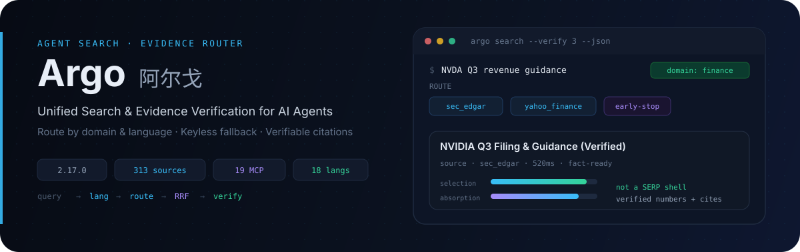
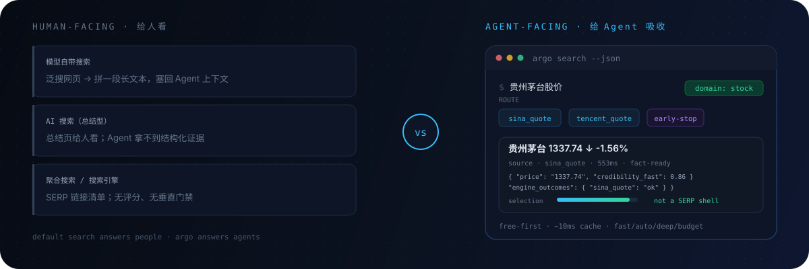
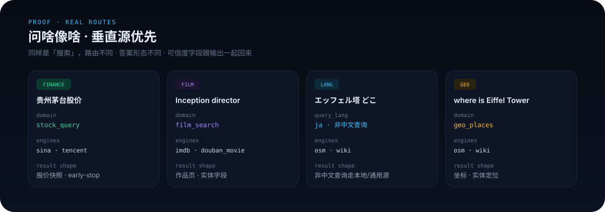
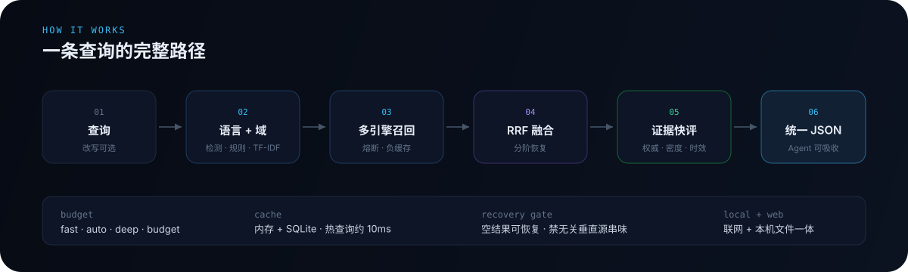
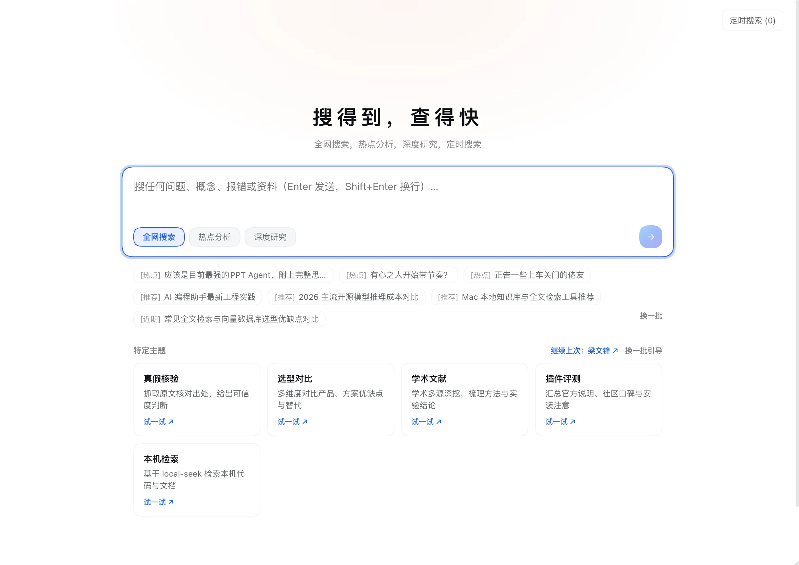
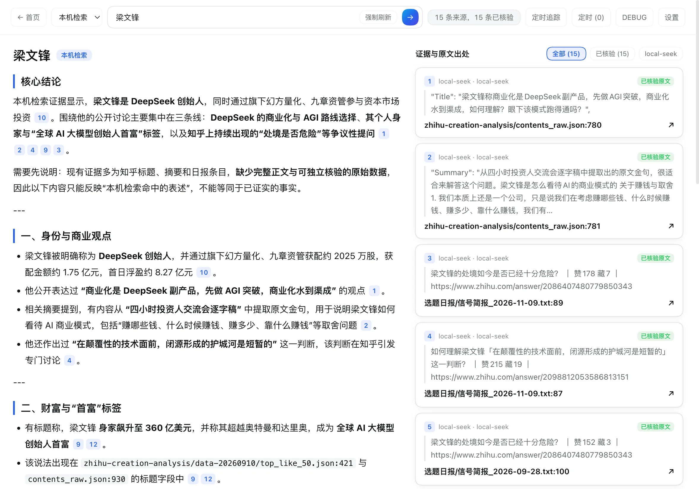

<p align="center">
  
</p>

<p align="center">
  <strong>English</strong> ·
  <a href="README.zh.md">中文</a> ·
  <a href="README.ja.md">日本語</a> ·
  <a href="README.ko.md">한국어</a> ·
  <a href="README.es.md">Español</a>
</p>

<p align="center">
  <a href="#quick-start">Quick Start</a> ·
  <a href="#why-argo">Why Argo</a> ·
  <a href="#query-shaped-routing">Routing Proof</a> ·
  <a href="#how-it-works">How It Works</a> ·
  <a href="#ai-search--sub-skills">AI Search &amp; Sub-skills</a> ·
  <a href="#dsh-plugin">DSH Plugin</a> ·
  <a href="#docs--changelog">Docs</a>
</p>

<p align="center">
  <a href="https://github.com/taxueseek/argo/stargazers"></a>
  <a href="https://www.npmjs.com/package/argo-search"></a>
  <a href="https://skills.sh/taxueseek/argo"></a>
  
  
  
  
  
</p>

> **Part of the taxueseek skill series** (search &amp; deep research): [plainspoken-writing](https://github.com/taxueseek/plainspoken-writing) 75★ (AI-tone removal) · [session-digger](https://github.com/taxueseek/session-digger) 34★ (cross-environment session mining) · [taxue-invest](https://github.com/taxueseek/taxue-invest) 30★ (investment analysis) · [taxueskills](https://github.com/taxueseek/taxueskills) 25★ (decision system) · [taxue-creative-style](https://github.com/taxueseek/taxue-creative-style) 19★ (creative illustration styles) · [ime-lexicon](https://github.com/taxueseek/ime-lexicon) 15★ (IME lexicon toolkit).
>
> **DeepSeek Harness (DSH) plugin ecosystem**: [dsh-files](https://github.com/taxueseek/dsh-files) 43★ (folder upload + document parsing) · [plugin-fast-adapt](https://github.com/taxueseek/plugin-fast-adapt) 15★ (plugin upgrade adapter) · [taxue-dsh-artisan](https://github.com/taxueseek/taxue-dsh-artisan) 3★ (visual creation) · [dsh-plugin-guard](https://github.com/taxueseek/dsh-plugin-guard) 2★ (pre-install audit).

**Argo** is an open-source metasearch, web-fetch, and evidence-verification engine that lives inside your AI agent. It routes queries across **hundreds of sources** in **18 languages** (web, academic, finance, code, local files, and leading **AI search engines**), falls back to **keyless &amp; local engines** when API keys are absent, and verifies facts from full page text instead of trusting search snippets.

---

## Quick Start

Zero-config works out of the box (API keys are optional). Pick your client:

- **Claude Code (MCP)**:
  ```bash
  claude mcp add argo -- npx -y argo-search
  ```
- **Agent Skill (`skills.sh` — Claude Code, Cursor, Codex, Antigravity)**:
  ```bash
  npx skills add taxueseek/argo
  # Or install all 3 standalone Skills (argo, argo-wide-research, local-seek):
  npx skills add taxueseek/argo --full-depth --all
  ```
- **Cursor / Windsurf / LibreChat (`mcpServers` JSON)**:
  ```json
  {
    "mcpServers": {
      "argo": { "command": "npx", "args": ["-y", "argo-search"] }
    }
  }
  ```
- **Local CLI (recommended for long-term local use)**:
  ```bash
  curl -fsSL https://raw.githubusercontent.com/taxueseek/argo/main/scripts/install.sh | bash
  # Windows (PowerShell): irm https://raw.githubusercontent.com/taxueseek/argo/main/scripts/install.ps1 | iex
  # or via npm: npm install -g argo-search
  ```
- **DeepSeek Harness (DSH) Plugin**:
  ```bash
  dsh plugin --profile web add argo-search
  ```

<details>
<summary>Verify installation, requirements &amp; optional API keys</summary>

```bash
argo search "python asyncio error handling" --verify 2 --json --fields agent
argo search --list-engines
```

- Requires **Python 3.9+** (`pip install pyyaml`) and **Node.js 18+** (for `npx`).
- Optional keys (`DEEPSEEK_API_KEY`, `ARGO_YUANBAO_API_KEY`, `ARGO_TAVILY_API_KEY`, `EXA_API_KEY`, `ARGO_METASO_API_KEY`, `ARGO_BOCHA_API_KEY`) improve quality when present and are skipped automatically when missing. See [docs/MCP_SETUP.md](docs/MCP_SETUP.md) and [docs/ENGINE_CATALOG.md](docs/ENGINE_CATALOG.md).

</details>

---

## Why Argo

<p align="center">
  
</p>

| Capability | Built-in Web Search | Commercial Search APIs (Tavily / Exa / Serper) | Argo |
| :--- | :--- | :--- | :--- |
| **Pricing &amp; Keys** | Tied to host quota | Paid per call; API key required | **Free &amp; keyless fallback** (optional keys boost quality) |
| **AI Search Aggregation** | Single host backend | Single vendor index | **Unifies keyless (`tavily_free`, `parallel_free`, `anysearch`) + BYOK (DeepSeek Search, Tencent Yuanbao/Hunyuan, Metaso, Bocha, Tavily, Exa)** |
| **Source Routing** | Single generic index | Generic web index | **Domain + 18-language routing** across academic, finance, code, news &amp; local files |
| **Fact Verification** | Snippet only | Snippet or raw chunks | **Built-in `--verify` &amp; `--numverify`** (fetches source &amp; scores credibility) |
| **Context Efficiency** | Verbose HTML/JSON | Raw chunks | **Agent-compact output** (`--fields agent` ~4.3 KB) |

---

## Query-Shaped Routing

<p align="center">
  
</p>

Argo classifies each query by **domain and language** before dispatching, hitting first-party sources directly and triggering **early-stop** once consensus is reached:

- **Academic** → `arxiv`, `semantic_scholar`, `openalex`, `crossref`, `pubmed` (`--academic-deep`)
- **Finance &amp; Macro** → `sec_edgar`, `yahoo_finance`, `sina_quote`, `eastmoney`
- **Code &amp; Tech** → `stackoverflow`, `github`, `octen`, `context7`
- **AI Search** → `tavily_free`, `parallel_free`, `anysearch`, `deepseek_search`, `yuanbao`, `metaso`, `bocha`, `exa`, `tavily`, `you`
- **Deep Research** → `python3 scripts/research.py "topic" --depth deep --json` outputs a structured **dossier** (sources, coverage gaps, quality gates)

---

## How It Works

<p align="center">
  
</p>

### Evidence Scoring (Selection × Absorption)

Search engines optimize for clicks; agents need **verifiable facts**. Argo scores every candidate along two orthogonal axes:
- **Selection**: domain authority, consensus across engines (`RRF`), freshness, and SERP-shell rejection (blocks `baidu/s` and `sogou/link` redirect stubs from posing as primary sources).
- **Absorption**: actual readable density after fetching the full page (`--verify N`) and numerical cross-checking (`--numverify N` for prices, financials, and dates).

### Budget Modes (`--mode`)

| Mode | Behavior | Best for |
| :--- | :--- | :--- |
| **`fast`** | Free + local `local_*` engines only, zero API spend | High-frequency agent lookups |
| **`auto`** | Cost-aware default: free first, escalates to keyed sources when needed | Daily coding &amp; general research |
| **`deep`** | Broad multi-source fan-out, disables early-stop, pairs with `--verify` | High-stakes finance, legal, academic dossiers |
| **`budget`** | Strict daily/monthly quota caps with local fallback | Unattended batch &amp; cron workflows |

---

## AI Search &amp; Sub-skills

### Skills &amp; Internal Modules

Argo exposes **3 orthogonal Skills** (`argo`, `argo-wide-research`, `local-seek`) and bundles **3 internal pipelines** under `sub-skills/` driven via CLI flags or fallbacks:

| Module | Type | Capability |
| :--- | :--- | :--- |
| **argo-wide-research** | Standalone Skill | Multi-track parallel deep research &amp; forensics orchestration with citation ledger and quality gates |
| **local-seek** | Standalone Skill | Hybrid BM25F rerank + FTS5 + fzf search for local notes, markdown, and code (`argo seek`) |
| **local-search** | Internal Pipeline | 30 zero-cost local aggregation engines (`--local-first`) |
| **ego-search** | Subcommand (`argo ego-search`) | Real-browser logged-in search for Zhihu, Xiaohongshu, WeChat Official Accounts (off by default) |
| **js-run** | Internal Pipeline | Sub-millisecond headless JS execution for environment probes and pure-compute pages |

### 19 MCP Tools

`argo_search`, `argo_local_search`, `argo_local_read`, `argo_recompute`, `argo_research`, `argo_evidence`, `argo_clarify`, `argo_fetch`, `argo_crawl`, `argo_screenshot`, `argo_pdf`, `argo_social_search`, `argo_article`, `argo_job`, `argo_extract`, `argo_preflight`, `argo_answer`, `argo_watch`, `argo_cite`.

---

## DSH Plugin

Argo ships a first-class **DeepSeek Harness (DSH)** plugin (`@taxueseek/argo-dsh`) with three invocation channels from one capability set:
1. **19 `mcp__argo__*` tools** (full MCP bundle; default MCP surface exposes 4 core tools, set `ARGO_MCP_TOOLS=all` for all 19).
2. **Search + `wide_research` parallel orchestration** (subpackage).
3. **Host `web_search` / `web_fetch` seam replacement** (requires explicit provider pin in the web profile; see [packages/dsh-plugin/README.md](packages/dsh-plugin/README.md)).

The built-in **Argo Workbench** provides a browser UI with 5 modes (Web Search, Hot Topics, Deep Research, Local Search, Scheduled Search), adaptive home suggestions, and a side-by-side verified evidence panel; the settings UI exposes **18 native first-class tools**, **35 behaviour switches**, and shares DSH's native `DEEPSEEK_API_KEY` credential store with zero plaintext echoing:

<table>
  <tr>
    <td align="center" width="50%">
      <br>
      <sub><b>Argo Workbench — Home</b>: 5 search modes, adaptive suggestions &amp; specialized theme cards</sub>
    </td>
    <td align="center" width="50%">
      <br>
      <sub><b>Argo Workbench — Evidence View</b>: structured synthesis + verified source &amp; line-level citations</sub>
    </td>
  </tr>
</table>

<table>
  <tr>
    <td align="center" width="33%">
      <br>
      <sub><b>Settings — Tools</b> (18 native tools)</sub>
    </td>
    <td align="center" width="33%">
      <br>
      <sub><b>Settings — Engines</b> (35 switches &amp; quotas)</sub>
    </td>
    <td align="center" width="33%">
      <br>
      <sub><b>Settings — Keys</b> (shared DSH store)</sub>
    </td>
  </tr>
</table>

---

## Docs &amp; Changelog

- [docs/ENGINE_CATALOG.md](docs/ENGINE_CATALOG.md) · [docs/MCP_SETUP.md](docs/MCP_SETUP.md) · [docs/ARGO_INTRO.md](docs/ARGO_INTRO.md) · [docs/为什么选择argo.md](docs/为什么选择argo.md) · [docs/CHANGELOG.md](docs/CHANGELOG.md)

| Version | Highlights |
| :--- | :--- |
| **v2.16.0** | DSH Argo Workbench UI, direct 4-stage CLI verification, `linux.do` + Keenable free channel (312 sources), Jina keyless fallback, concurrency &amp; cache hardening |
| **v2.15.0** | Zhihu full chain, evidence-layer authority passthrough, keyless 3-tier semantic fallback, MCP generic connector (`type: mcp`), route zero-based domain scoring, 311 sources |
| **v2.14.1** | Architecture slimming, MCP 3+1 orthogonal tools + backward-compat aliases, 304 sources, fail-closed `secret_guard.py` redaction |
| **v2.14.0** | Parser layer consolidation, 300 sources, badcase ledger loop |
| **v2.13.0** | Documentation consolidation, 22-state-machine SSOT, dispatch tail grace |

<details>
<summary>v2.16.0 Release Summary &amp; Capability Snapshot</summary>

### Capabilities (v2.16.0)

v2.16.0 introduces the browser-based **Argo Workbench** in the DSH plugin (5 modes, adaptive home suggestions, theme cards, and side-by-side verified citations) backed by a direct `bin/argo` CLI 4-stage verification pipeline and `local-seek` integration; adds the `linux.do` community source (311→312 sources) and activates the `keenable` free channel (100k/mo); refactors Jina Reader to keyed-with-keyless-fallback; and hardens circuit-breaker, quota, cache-slot, and routing-latency behaviour.

### v2.16.0: Argo Workbench UI + Direct 4-Stage Pipeline + Sources &amp; Concurrency Hardening

See [docs/RELEASE_NOTES_v2.16.0.md](docs/RELEASE_NOTES_v2.16.0.md) and [docs/CHANGELOG.md](docs/CHANGELOG.md).

### v2.15.0: Zhihu Full Chain + Evidence Authority Passthrough + MCP Connector

See [docs/RELEASE_NOTES_v2.15.0.md](docs/RELEASE_NOTES_v2.15.0.md) and [docs/CHANGELOG.md](docs/CHANGELOG.md).

### v2.14.1: Architecture Slimming + MCP 3+1 Tools + Security Redaction

See [docs/RELEASE_NOTES_v2.14.1.md](docs/RELEASE_NOTES_v2.14.1.md) and [docs/CHANGELOG.md](docs/CHANGELOG.md).

</details>

---

> Good search is not about seeing more—it is about concluding with confidence, and knowing when you still should not.

<p align="center">
  <picture>
    <source media="(prefers-color-scheme: dark)"
      srcset="https://api.star-history.com/svg?repos=taxueseek/argo&type=Date&theme=dark" />
    <source media="(prefers-color-scheme: light)"
      srcset="https://api.star-history.com/svg?repos=taxueseek/argo&type=Date" />
    
  </picture>
</p>

If Argo has ever helped you reach a more confident conclusion, [give it a Star](https://github.com/taxueseek/argo/stargazers) to help more people find it.

## Contributing &amp; License

Issues and PRs are welcome (see [docs/ADDING_NEW_ENGINE.md](docs/ADDING_NEW_ENGINE.md) to add a source). Licensed under [Apache-2.0](LICENSE).
