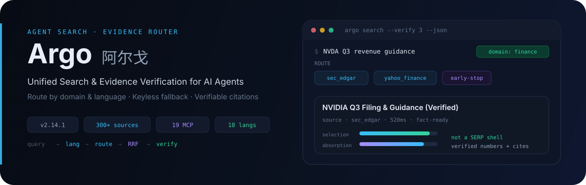

<p align="center">
  
</p>

<p align="center">
  <strong>English</strong> ·
  <a href="README.zh.md">中文</a> ·
  <a href="README.ja.md">日本語</a> ·
  <a href="README.ko.md">한국어</a> ·
  <a href="README.es.md">Español</a>
</p>

<p align="center">
  <a href="#quick-start">Quick Start</a> ·
  <a href="#why-argo">Why Argo</a> ·
  <a href="#proof">Live Proof</a> ·
  <a href="#capabilities">Capabilities</a> ·
  <a href="#dsh-plugin">DSH Plugin</a> ·
  <a href="#docs--changelog">Docs</a>
</p>

<p align="center">
  <a href="https://github.com/taxueseek/argo/stargazers"></a>
  <a href="https://www.npmjs.com/package/argo-search"></a>
  <a href="https://skills.sh/taxueseek/argo"></a>
  
  
  
  
  
</p>

**Argo** is an open-source metasearch, web-fetch, and evidence-verification engine built for AI agents. It routes queries across **hundreds of sources** in **18 languages** (academic, code, finance, news, local files), falls back to **keyless & local engines** when API keys are absent, and verifies facts from full page text instead of trusting search snippets.

---

## Quick Start

Zero-config works out of the box (API keys are optional). Pick your client:

- **Claude Code (MCP)**:
  ```bash
  claude mcp add argo -- npx -y argo-search
  ```
- **Agent Skill (`skills.sh` — Claude Code, Cursor, Codex, Antigravity)**:
  ```bash
  npx skills add taxueseek/argo
  ```
- **Cursor / Windsurf / LibreChat (`mcpServers` JSON)**:
  ```json
  {
    "mcpServers": {
      "argo": { "command": "npx", "args": ["-y", "argo-search"] }
    }
  }
  ```
- **Local CLI (recommended for long-term local use)**:
  ```bash
  curl -fsSL https://raw.githubusercontent.com/taxueseek/argo/main/scripts/install.sh | bash
  # or via npm: npm install -g argo-search
  ```
- **DeepSeek Harness (DSH) Plugin**:
  ```bash
  dsh plugin --profile web add argo-search
  ```

<details>
<summary>Verify installation &amp; optional API keys</summary>

```bash
argo search "python asyncio error handling" --json --fields agent
argo search --list-engines
```

- Requires **Python 3.9+** (`pip install pyyaml`) and **Node.js 18+** (for `npx`).
- Optional keys (`DEEPSEEK_API_KEY`, `TAVILY_API_KEY`, `EXA_API_KEY`, etc.) improve quality when present and are skipped automatically when missing. See [docs/MCP_SETUP.md](docs/MCP_SETUP.md) for multi-client injection and [docs/ENGINE_CATALOG.md](docs/ENGINE_CATALOG.md) for all engines.

</details>

---

## Why Argo

| Capability | Built-in Web Search | Commercial Search APIs (Tavily / Exa / Serper) | Argo |
| :--- | :--- | :--- | :--- |
| **Pricing & Keys** | Tied to host quota | Paid per call; requires API key | **Free & keyless fallback** (optional keys boost quality) |
| **Source Routing** | Single generic index | Generic web index | **Domain + language routing** across 18 languages & verticals |
| **Fact Verification** | Snippet only | Snippet or raw text | **Built-in `--verify` & `--numverify`** (fetches source & scores credibility) |
| **Local + Login Walls** | None | None | **Local files, semantic notes (`local-seek`), logged-in web (`ego-search`)** |
| **Context Efficiency** | Verbose HTML/JSON | Raw chunks | **Agent-compact Markdown/JSON** (`--fields agent` ~4.3 KB) |

---

## Proof

```bash
$ argo search "python asyncio error handling" --verify 2 --json --fields agent
```

Instead of returning SEO-farm blogspam, Argo detects `domain: code`, routes directly to StackOverflow's official API and GitHub Discussions, fetches the top pages with `--verify 2`, and returns structured evidence with credibility scores and source URLs.

- **Academic queries** → `arxiv`, `semantic_scholar`, `openalex`, `crossref`, `pubmed`
- **Finance queries** → `sec_edgar`, `yahoo_finance`, `sina_quote`, `eastmoney`
- **Deep research** → `python3 scripts/research.py "topic" --depth deep --json` produces a structured **dossier** (sources, coverage gaps, quality gates)

---

## Capabilities

### Four Sub-skills

| Sub-skill | What it does |
| :--- | :--- |
| **local-search** | Local file search + 32 zero-cost local aggregation engines (`--local-first`) |
| **local-seek** | Hybrid BM25 + vector semantic search for local notes, markdown, and knowledge bases |
| **ego-search** | Real-browser logged-in search for Zhihu, Xiaohongshu, WeChat Official Accounts (off by default) |
| **js-run** | Sub-millisecond headless JS execution for environment probes and pure-compute pages |

### 19 MCP Tools

Argo exposes **19 MCP tools** aligned with its CLI: `argo_search`, `argo_local_search`, `argo_local_read`, `argo_recompute`, `argo_research`, `argo_evidence`, `argo_clarify`, `argo_fetch`, `argo_crawl`, `argo_screenshot`, `argo_pdf`, `argo_social_search`, `argo_article`, `argo_job`, `argo_extract`, `argo_preflight`, `argo_answer`, `argo_watch`, `argo_cite`.

<details>
<summary>CLI flags &amp; budget modes</summary>

- `--mode fast|auto|deep|budget`: free fast path / cost-aware default / deep multi-source / quota-saving
- `--verify N` / `--numverify N`: fetch top-N URLs and verify text & numbers
- `--since 7d` / `--sort newest`: time-window filtering and sorting
- `--fields agent`: compact output (~4.3 KB) for LLM context budgets

</details>

---

## DSH Plugin

Argo ships a first-class **DeepSeek Harness (DSH)** plugin (`@taxueseek/argo-dsh`) with **18 native tools**, `wide_research` parallel orchestration, and a 6-tab settings UI (Access, Tools, Engines, Keys, Research, Advanced) that shares DSH's native `DEEPSEEK_API_KEY` credential store. See [packages/dsh-plugin/README.md](packages/dsh-plugin/README.md) for setup and `web_search` / `web_fetch` seam pinning.

---

## Docs & Changelog

- [docs/ENGINE_CATALOG.md](docs/ENGINE_CATALOG.md) — full engine catalog (auto-generated)
- [docs/MCP_SETUP.md](docs/MCP_SETUP.md) — multi-client MCP setup (Claude, Cursor, Codex, Windsurf, Cline)
- [docs/ARGO_INTRO.md](docs/ARGO_INTRO.md) · [docs/为什么选择argo.md](docs/为什么选择argo.md) — architecture & design trade-offs
- [docs/CHANGELOG.md](docs/CHANGELOG.md) — full release history

| Version | Highlights |
| :--- | :--- |
| **v2.14.1** | Architecture slimming, MCP 3+1 orthogonal tools + backward-compat aliases, 304 sources, fail-closed `secret_guard.py` redaction |
| **v2.14.0** | Parser layer consolidation, 300 sources, badcase ledger loop |
| **v2.13.0** | Documentation consolidation, 22-state-machine SSOT, dispatch tail grace |

## Contributing & License

Issues and PRs are welcome (see [docs/ADDING_NEW_ENGINE.md](docs/ADDING_NEW_ENGINE.md) to add a source). Licensed under [Apache-2.0](LICENSE).

<details>
<summary>v2.14.1 Release Summary &amp; Capability Snapshot</summary>

### Capabilities (v2.14.1)

v2.14.1 slims the source architecture, converges MCP tools to 3+1 orthogonal core interfaces with backward-compatible aliases, expands keyless sources (Hugging Face Datasets, Maven Central, NuGet, Open-Meteo), and adds fail-closed `secret_guard.py` output redaction.

### v2.14.1: Architecture Slimming + MCP 3+1 Tools + Security Redaction

See [docs/RELEASE_NOTES_v2.14.1.md](docs/RELEASE_NOTES_v2.14.1.md) and [docs/CHANGELOG.md](docs/CHANGELOG.md).

</details>
