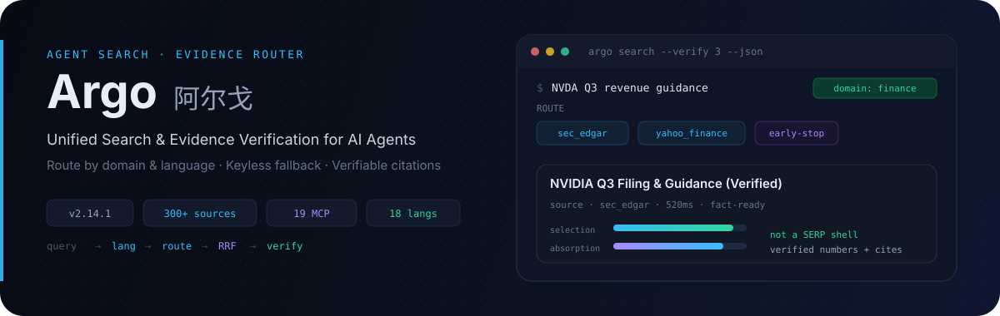
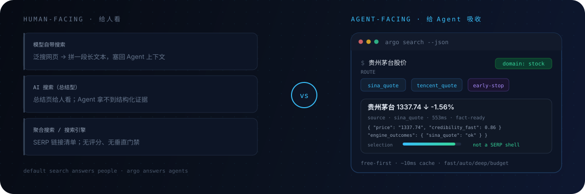
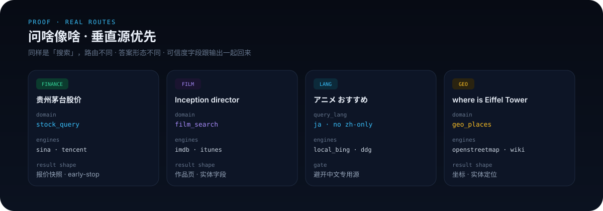
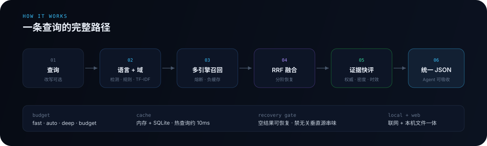

<p align="center">
  
</p>

<p align="center">
  <a href="README.md">English</a> ·
  <strong>中文</strong> ·
  <a href="README.ja.md">日本語</a> ·
  <a href="README.ko.md">한국어</a> ·
  <a href="README.es.md">Español</a>
</p>

<p align="center">
  <a href="#快速上手零配置可用">快速上手</a> ·
  <a href="#为什么选择-argo">对比评测</a> ·
  <a href="#按查询形态自动路由">路由实证</a> ·
  <a href="#工作原理与证据核验">工作原理</a> ·
  <a href="#ai-搜索与子技能矩阵">AI 搜索与子技能</a> ·
  <a href="#dsh-插件">DSH 插件</a> ·
  <a href="#文档与更新记录">文档</a>
</p>

<p align="center">
  <a href="https://github.com/taxueseek/argo/stargazers"></a>
  <a href="https://www.npmjs.com/package/argo-search"></a>
  <a href="https://skills.sh/taxueseek/argo"></a>
  
  
  
  
  
</p>

> **属于 taxueseek Skill 系列**（负责搜索与深度研究）：[plainspoken-writing](https://github.com/taxueseek/plainspoken-writing) 75★（专业消除 AI 味）· [session-digger](https://github.com/taxueseek/session-digger) 34★（跨环境会话历史挖掘）· [taxue-invest](https://github.com/taxueseek/taxue-invest) 30★（投资分析方法论）· [taxueskills](https://github.com/taxueseek/taxueskills) 25★（踏雪决策系统）· [taxue-creative-style](https://github.com/taxueseek/taxue-creative-style) 19★（创意插画风格库）· [ime-lexicon](https://github.com/taxueseek/ime-lexicon) 15★（豆包/微信输入法词库工具）。
>
> **同作者 DeepSeek Harness（DSH）插件生态**：[dsh-files](https://github.com/taxueseek/dsh-files) 43★（文件夹上传与文档解析）· [plugin-fast-adapt](https://github.com/taxueseek/plugin-fast-adapt) 15★（插件升级自适应）· [taxue-dsh-artisan](https://github.com/taxueseek/taxue-dsh-artisan) 3★（一体化视觉创作）· [dsh-plugin-guard](https://github.com/taxueseek/dsh-plugin-guard) 2★（插件安装前安全体检）。

**Argo（阿尔戈）** 是专为 AI Agent 打造的开源多引擎搜索、网页抓取与证据核验工具。它把「**免费与本地引擎兜底 + 主流 AI 搜索聚合 + 公众号/知乎/小红书垂直穿透 + 原文抓取与证据核验**」融进同一套 CLI / MCP / Skill 接口，覆盖 18 种语言与近百个业务域。

---

## 快速上手（零配置可用）

- **Claude Code（MCP）**：
  ```bash
  claude mcp add argo -- npx -y argo-search
  ```
- **Agent Skill（`skills.sh` — Claude Code / Cursor / Codex / Antigravity）**：
  ```bash
  npx skills add taxueseek/argo
  # 或一次安装全部场景 Skill（argo / argo-deep-research / argo-local-search）：
  npx skills add taxueseek/argo --full-depth --all
  ```
- **Cursor / Windsurf / LibreChat（`mcpServers` JSON）**：
  ```json
  {
    "mcpServers": {
      "argo": { "command": "npx", "args": ["-y", "argo-search"] }
    }
  }
  ```
- **本地 CLI（长期使用推荐）**：
  ```bash
  curl -fsSL https://raw.githubusercontent.com/taxueseek/argo/main/scripts/install.sh | bash
  # 或 npm install -g argo-search
  ```
- **DeepSeek Harness（DSH）插件**：
  ```bash
  dsh plugin --profile web add argo-search
  ```

<details>
<summary>安装自检与可选 API Key 说明</summary>

```bash
argo search "贵州茅台最新财报核心指标" --verify 3 --json --fields agent
argo search --list-engines
```

- 运行要求：**Python 3.9+**（`pip install pyyaml`）与 **Node.js 18+**（使用 `npx` 时）。
- 所有 API Key 均为可选：有 Key 自动提质（如 `DEEPSEEK_API_KEY`、`ARGO_YUANBAO_API_KEY`、`ARGO_TAVILY_API_KEY`、`EXA_API_KEY`、`ARGO_METASO_API_KEY`、`ARGO_BOCHA_API_KEY`），无 Key 自动跳过并回落免密钥源与本地引擎。详见 [docs/MCP_SETUP.md](docs/MCP_SETUP.md) 与 [docs/ENGINE_CATALOG.md](docs/ENGINE_CATALOG.md)。

</details>

---

## 为什么选择 Argo

<p align="center">
  
</p>

| 对比维度 | 宿主内置搜索 | 单一商业 API（Tavily / Exa / Serper） | Argo |
| :--- | :--- | :--- | :--- |
| **费用与门槛** | 绑定宿主配额 | 需外币卡按次付费、强依赖 Key | **免密钥可用**，本地与免费源自动兜底，有 Key 自动增强 |
| **AI 搜索聚合** | 单一内置后端 | 仅自家单一索引 | **同时聚合免 Key AI 搜索（`tavily_free`、`felo`、`parallel_free`）与主流可选 Key AI 搜索（DeepSeek 官方搜索、腾讯元宝/混元、秘塔、博查、Tavily、Exa）** |
| **中文与垂直穿透** | 泛网页居多，SEO 噪音重 | 几乎无法穿透中文生态 | **原生覆盖公众号、知乎、小红书（`ego-search`）、A 股行情、学术论文与本地知识库** |
| **事实与数值核验** | 仅看摘要片段 | 摘要或原始切片 | **内置 `--verify` 与 `--numverify` 抓回正文并交叉印证数值，给出证据分** |
| **上下文体积** | 冗长 HTML/JSON | 原始文本块 | **`--fields agent` 极简输出（~4.3 KB）**，不撑爆 Agent 上下文 |

---

## 按查询形态自动路由

<p align="center">
  
</p>

Argo 会在派发前识别查询的**域与语种**，直击一手垂直源并在达成共识后触发 **early-stop（早停）**：

- **AI 搜索聚合**：免 Key（`tavily_free`、`felo`、`parallel_free`、`anysearch`）+ 可选 Key（**DeepSeek 官方搜索 `deepseek_search`**、**腾讯元宝/混元搜索 `yuanbao`**、**秘塔 `metaso`**、**博查 `bocha`/`bocha_ai`**、**Tavily**、**Exa**、**You.com**）
- **金融与宏观**：`sec_edgar`、`yahoo_finance`、`sina_quote`、`eastmoney`
- **学术与论文**：`arxiv`、`semantic_scholar`、`openalex`、`crossref`、`pubmed`（支持 `--academic-deep`）
- **代码与技术**：`stackoverflow`、`github`、`octen`、`context7`
- **深度研究取证包**：`python3 scripts/research.py "复杂问题" --depth deep --json` 产出带来源账本、覆盖缺口与质量门控的 **dossier（取证包）**

---

## 工作原理与证据核验

<p align="center">
  
</p>

### 证据评分（选拔 × 吸收两维）

搜索引擎按点击率排序，但 Agent 需要**可核验的事实**：
- **选拔分（Selection）**：域权威度、多引擎共识（`RRF`）、时效性，并主动拦截 `baidu/s`、`sogou/link` 等 SERP 跳转空壳。
- **吸收分（Absorption）**：通过 `--verify N` 抓回正文后计算真实可读信息密度，高后果财务/价格/指标支持 `--numverify N` 抓原文做数值交叉印证。

### 四档预算模式（`--mode`）

| 模式 | 策略说明 | 适用场景 |
| :--- | :--- | :--- |
| **`fast`** | 仅用免费源与本地 `local_*` 引擎，零 API 消耗 | 高频日常查询 |
| **`auto`** | 成本感知默认档：免费优先，必要时再升级付费源 | 日常编码与常规调研 |
| **`deep`** | 多源并行展开、禁用早停，配合 `--verify` 深抓正文 | 金融、医疗、法律、深度研究取证 |
| **`budget`** | 严格遵守日/月配额上限，超限自动回落本地源 | 定时任务与无人值守批处理 |

---

## AI 搜索与子技能矩阵

### 四个内置子技能

| 子技能 | 核心能力 |
| :--- | :--- |
| **local-search** | 本机文件检索 + 32 个零成本本地聚合引擎（`--local-first`） |
| **local-seek** | 本地笔记、Markdown 与知识库的 BM25 + 向量混合语义检索 |
| **ego-search** | 基于真实浏览器的登录态垂直搜索（知乎、小红书、微信公众号，默认关闭） |
| **js-run** | 无浏览器毫秒级沙箱跑网页 JS（环境探测与纯计算页面） |

### 19 个 MCP 工具

`argo_search`、`argo_local_search`、`argo_local_read`、`argo_recompute`、`argo_research`、`argo_evidence`、`argo_clarify`、`argo_fetch`、`argo_crawl`、`argo_screenshot`、`argo_pdf`、`argo_social_search`、`argo_article`、`argo_job`、`argo_extract`、`argo_preflight`、`argo_answer`、`argo_watch`、`argo_cite`。

---

## DSH 插件

Argo 提供完整的 **DeepSeek Harness（DSH）** 插件（`@taxueseek/argo-dsh`），同一套能力支持三条调用通道：
1. **19 个 `mcp__argo__*` 工具**（主包接入，与完整 MCP 对齐）。
2. **搜索工具 + `wide_research` 并行研究编排**（子包）。
3. **接管宿主 `web_search` / `web_fetch` 接缝**（在 web profile 中需显式指定 provider pin，避免 `WEB_PROVIDER_AMBIGUOUS`，详见 [packages/dsh-plugin/README.md](packages/dsh-plugin/README.md)）。

内置图形设置中心覆盖 **18 个原生一级工具开关**、**28 项引擎行为开关**，并与宿主原生共享 `DEEPSEEK_API_KEY` 凭据库（永不明文回显）：

<p align="center">
  
  
  
</p>

---

## 文档与更新记录

- [docs/ENGINE_CATALOG.md](docs/ENGINE_CATALOG.md) · [docs/MCP_SETUP.md](docs/MCP_SETUP.md) · [docs/为什么选择argo.md](docs/为什么选择argo.md) · [docs/ARGO_INTRO.md](docs/ARGO_INTRO.md) · [docs/CHANGELOG.md](docs/CHANGELOG.md)

| 版本 | 核心更新 |
| :--- | :--- |
| **v2.14.1** | 信源架构精简、MCP 3+1 收敛与向后兼容别名、304 个源、`secret_guard.py` 故障安全脱敏 |
| **v2.14.0** | 解析层收敛、300 个源、坏例账本闭环 |
| **v2.13.0** | 文档收口、22 台状态机单一真源、派发尾宽宽限 |

<details>
<summary>v2.14.1 版本摘要与当前能力</summary>

### 当前大致能力（v2.14.1）

v2.14.1 完成信源架构精简、免认证新源接入（Hugging Face Datasets、Maven Central、NuGet、Open-Meteo）、MCP 3+1 收敛与向后兼容别名，以及 `secret_guard.py` 故障安全脱敏。

### v2.14.1：信源架构精简 + MCP 3+1 收敛 + 安全脱敏

详见 [docs/RELEASE_NOTES_v2.14.1.md](docs/RELEASE_NOTES_v2.14.1.md) 与 [docs/CHANGELOG.md](docs/CHANGELOG.md)。

</details>

## 参与贡献与开源协议

欢迎提交 Issue 与 PR（新增搜索源请见 [docs/ADDING_NEW_ENGINE.md](docs/ADDING_NEW_ENGINE.md)）。项目采用 [Apache-2.0](LICENSE) 协议开源。
